<div align="center">


# rohy — Low-Level Design

**A technical deep dive into how rohy actually works.**

Go + Wails + Svelte · version stated in [README.md](README.md)

</div>

---

## 0. Read this first

This document explains **how rohy is built**, one layer at a time. It is written
for someone who has never seen the codebase — including someone in their first
year of writing software. Every section follows the same shape:

> **What it does** → **How it works** → **Why it was built that way**

That last part matters most. Almost every unusual decision in rohy exists
because the obvious version was tried first and measured, and it lost. Where
that happened, the numbers are in the text.

### Three ideas that explain most of the codebase

If you only remember three things, remember these. They come up in nearly every
section below.

| Idea                                | What it means in practice                                                                                                                                            |
| ----------------------------------- | -------------------------------------------------------------------------------------------------------------------------------------------------------------------- |
| **Evidence is never edited**        | What gets ingested is stored exactly as ingested. Opinions (findings, layout, enabled-flags) live in separate files _beside_ the data, never inside it.               |
| **Never lie about missing data**    | An event with no timestamp shows `—`, not a made-up date. A rule that matched nothing leaves no graph. A count that excludes rows says so.                            |
| **Inferred ≠ asserted**             | A relation a rule produced (`created_by: system`) and a relation a human drew (`created_by: user`) are stored, filtered, and drawn differently. They never look alike. |

### Conventions used here

- `P4`, `P17`, `R-V1` in source comments are **phase** and **rule** identifiers
  from the project's build plan. You will see them in code comments. They are
  historical markers, not something you need to look up.
- File references look like [backend/graphene/schema.go](backend/graphene/schema.go)
  and are clickable.
- Diagrams are Mermaid and render inline on GitHub.

### Glossary (skim now, refer back later)

| Term                     | Meaning                                                                                                              |
| ------------------------ | -------------------------------------------------------------------------------------------------------------------- |
| **EVTX**                 | Windows' binary event-log file format. `.evtx` files live in `C:\Windows\System32\winevt\Logs`.                       |
| **Channel**              | A named log stream inside Windows — `Security`, `System`, `Microsoft-Windows-PowerShell/Operational`.                 |
| **Record ID**            | A monotonically increasing number Windows assigns each record within a channel. Used as a resume bookmark.            |
| **Node / Edge**          | Graph database terms. rohy stores each event as a **node** and each relation as an **edge**.                          |
| **Property index**       | A secondary lookup structure: "which nodes have `channel = Security`?" Avoids scanning everything.                    |
| **WAL**                  | Write-Ahead Log. Changes are appended to a log before being applied, so a crash can be replayed rather than lost.     |
| **Hydrate**              | Decode a stored record from bytes back into a Go struct. Expensive when done for thousands of rows.                   |
| **Cold store**           | A place to keep rarely-read bulky data so it is not loaded with everything else. rohy has one for raw event payloads. |
| **Sidecar**              | A small JSON file stored next to the main database, holding something the database deliberately does not own.         |
| **Idempotent**           | Running it twice gives the same result as running it once. Re-ingesting a file adds no duplicates.                    |
| **Binding**              | A Go method Wails exposes to JavaScript. The frontend calls it like an async function.                                |

---

## 1. The system in one picture

rohy is **one process**. There is no server, no daemon, no network call. Wails
embeds a native webview (WebView2 on Windows, WebKitGTK on Linux, WKWebView on
macOS) into a Go binary, and the two halves talk over an in-process bridge.

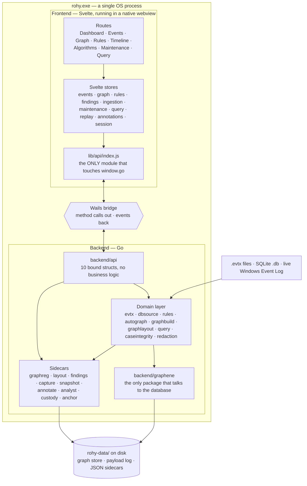

**Why a single process?** The data is forensic evidence. A client/server split
would mean evidence crossing a socket, a second thing to secure, and a second
thing to install. rohy's promise is "your case data never leaves the machine",
and the simplest way to keep a promise like that is to have nowhere for the data
to go.

---

## 2. Repository map

```
rohy/
├── main.go                  Wails entry point: window options + which structs to bind
├── app.go                   Lifecycle: open stores, wire bindings, startup/shutdown
│
├── backend/
│   ├── api/                 Wails binding layer — the Go↔JS boundary
│   ├── consts/              Every constant, message string and enum in one file
│   ├── evtx/                Ingestion pipeline: parse, normalize, dedup, batch, persist
│   ├── dbsource/            SQLite .db reader (two documented schemas)
│   ├── capture/             Durable per-channel bookmarks for live capture
│   ├── graphene/            Persistence facade — schema, queries, ordering, timeline,
│   │                        the correlation projection and its backfill
│   ├── payload/             Append-only cold store for bulky raw records
│   ├── rules/               Rule format, validation, registry, editor descriptor
│   ├── autograph/           Correlation engine (pure; produces edges, writes nothing)
│   │                        4 algorithms + the prepared Dataset shared across a build
│   ├── graphbuild/          The workflow that runs rules and persists their graphs
│   ├── graphreg/            Registry of named graphs
│   ├── layout/              Canvas node positions and viewport
│   ├── findings/            Analyst annotations (flag, tags, note)
│   ├── graphlayout/         Auto-layout profiles: positions from nodes and edges, pure (§14.1)
│   ├── snapshot/            What a graph looked like at a moment, and what can be put back (§14.5)
│   ├── annotate/            Notes, regions and arrows on a graph, in layers (§14.6)
│   ├── query/               The read-only query console: structured builder, no expression
│   │                        language (§16.1)
│   ├── caseintegrity/       The case check: reads and reports, repairs nothing (§18.7)
│   ├── eventproof/          Event proof documents: assemble and verify, storeless (§18.1)
│   ├── custody/             The case-fingerprint history and its exported copies (§18.2)
│   ├── redaction/           Removing one event's content, attributably, with a journal (§18.4)
│   ├── analyst/             Who works on the case: the analyst's own profile and the case's
│   │                        register of analysts and keys (§18.5)
│   ├── keyfile/             The analyst's Ed25519 signing key, encrypted at rest (§18.5)
│   ├── anchor/              Where each checkpoint's digest was published (§18.6)
│   ├── durable/             Crash-safe file replacement for the sidecars
│   ├── synth/               Synthetic EVTX, events and rules for tests and profiling only
│   ├── integration/         The real pipeline end to end on the disk backend (tests only)
│   ├── utils/               Hashing primitives
│   └── version/             Build identity, injected at link time
│
├── frontend/src/
│   ├── routes/              One file per page
│   ├── components/          events/ · graph/ · rules/ · timeline/ · query/ · maintenance/ ·
│   │                        session/ · learn/ · material/
│   ├── stores/              Svelte stores — all app state
│   └── lib/                 api/ · consts/ · graph/ · rules/ · query/ · maintenance/ ·
│                            session/ · learn/ · filter · shortcuts · export · motion · timeline
│
├── cmd/rohyctl/             CLI over the portable files: validate (lines, or --json),
│                            format, explain, verify-proof. Never opens a case
├── tools/
│   ├── genschema/           Writes the rule JSON Schema from the editor descriptor
│   ├── profile/             Profiles ingest, build and open on the disk backend
│   ├── vscode-rohy/         VS Code extension: rohyctl's check and format in the
│   │                        editor, the schema when rohyctl is absent (§10.3)
│   └── gen_icons.py         Draws the application icons from the one source mark
│
├── build-all.{sh,ps1}       Full six-target matrix build
├── build.{sh,ps1}           Single-target release build
└── .github/workflows/       ci.yml · release.yml
```

Roughly 33,700 lines of non-test Go, plus the Svelte frontend. The tests are
**1,207 Go test functions**, with 10 fuzz targets and 65 benchmarks beside them,
**855 frontend test cases** and **58 extension tests**.

---

## 3. Layering and the dependency rule

There is exactly one rule, and it is enforced by import direction:

> **A package may only import packages below it. Never sideways into a peer's
> internals, never upward.**

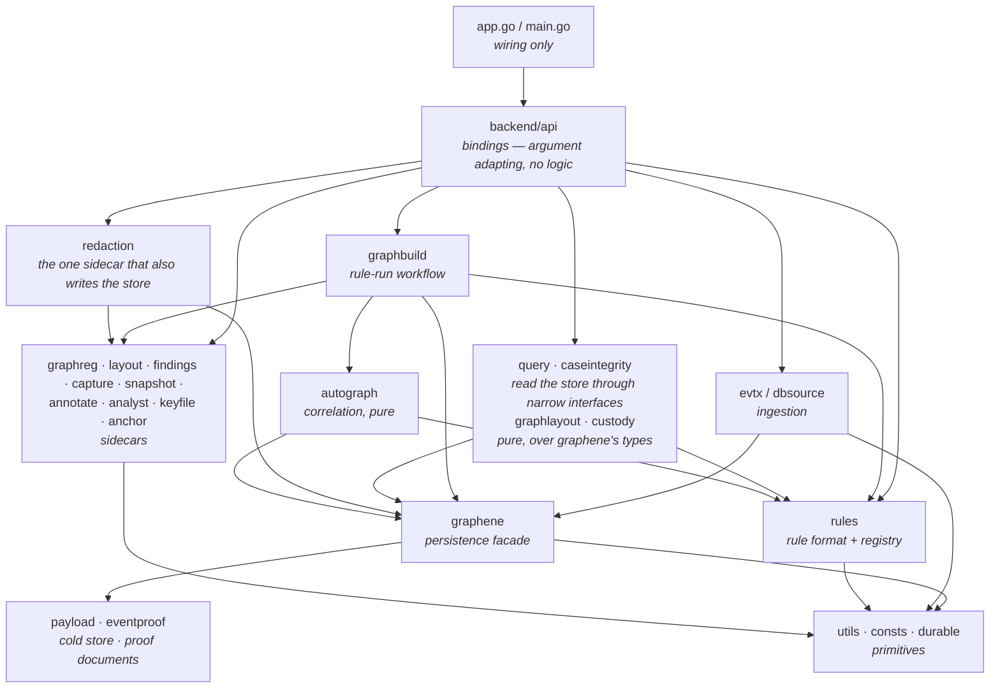

The sidecars sit above `graphene` in the picture but never import it: a
sidecar is a file beside the case, not a view of the store. `custody` keeps a
sidecar, but it imports `graphene` for its root and custody types and the pure
`VerifyChain`, so it is drawn with the packages above `graphene`. It never
reads the store itself: the API gathers the values it decides over, as it does
for `graphlayout`. `caseintegrity`
imports `rules` to read the rule set it checks; `redaction` imports `snapshot`
for the type its snapshot scrubber returns. `synth` (test data) and
`integration` (tests only) are left out.

Three consequences worth internalising:

1. **`graphene` is the only package that opens the database.** If you find
   yourself importing the graph library anywhere else, the design has been
   broken.
2. **`autograph` cannot write.** It returns unpersisted `Relation` values. This
   is what makes correlation trivially testable: feed it events, assert on the
   edges, no database involved.
3. **`api` holds no business logic.** Its methods parse a string into a
   `time.Time`, call one thing, and wrap the error. That is the whole job.
   Testing the bindings therefore does not require a running window.

Where a lower package needs something from above, it declares a **narrow
interface** instead of importing upward. `evtx.EventSink` is three methods;
`*graphene.Store` happens to satisfy it. `graphbuild.LayoutStore` is a single
`Delete` method. This keeps the arrows pointing one way and makes fakes trivial
in tests.

---

## 4. Cold start — what happens when you double-click rohy

The interesting problem: opening a large case means replaying a write-ahead log
and loading a property index. On a big case that is the slowest thing the app
ever does. Doing it before the window exists means the user stares at nothing
and assumes the app is broken.

So rohy **opens the window first and warms the store behind it**, reporting real
progress.

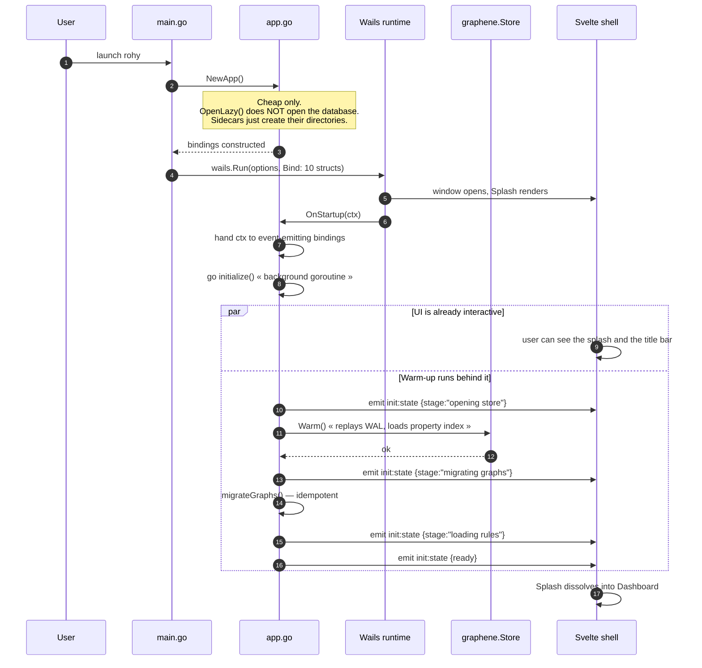

### The laziness is safe, not merely fast

`graphene.OpenLazy` returns a `Store` whose database is not open yet. Every
accessor funnels through `ensure()`, which is a `sync.Once`:

```go
func (s *Store) ensure() error {
    s.openOnce.Do(func() { /* open graph + payload log */ })
    return s.openErr
}
```

A call that arrives **before** warm-up finishes simply blocks until the open
completes. Laziness can therefore never surface as a nil dereference or a
half-open read — a property the `sync.Once` gives for free, along with the
happens-before edge that makes reading `s.g` lock-free afterwards.

### Failure is shown, not fatal

If warm-up fails, `initialize()` calls `System.Failed(err)` and returns. The
process stays alive and the window shows the reason. A user who can read
"permission denied on rohy-data/db" can fix it; a user whose app vanished
cannot.

### Shutdown

```go
func (a *App) shutdown(ctx context.Context) {
    a.Events.Shutdown()   // stop ingestion, let it flush + bookmark first
    a.store.Compact()     // merge delta layer, truncate the WAL
    a.store.Close()
}
```

The order matters. Draining ingestion **before** closing is what keeps a live
capture's bookmark honest: otherwise the next session would resume from a
position whose events were never written.

---

## 5. The data model

### 5.1 Two entities, and that is all

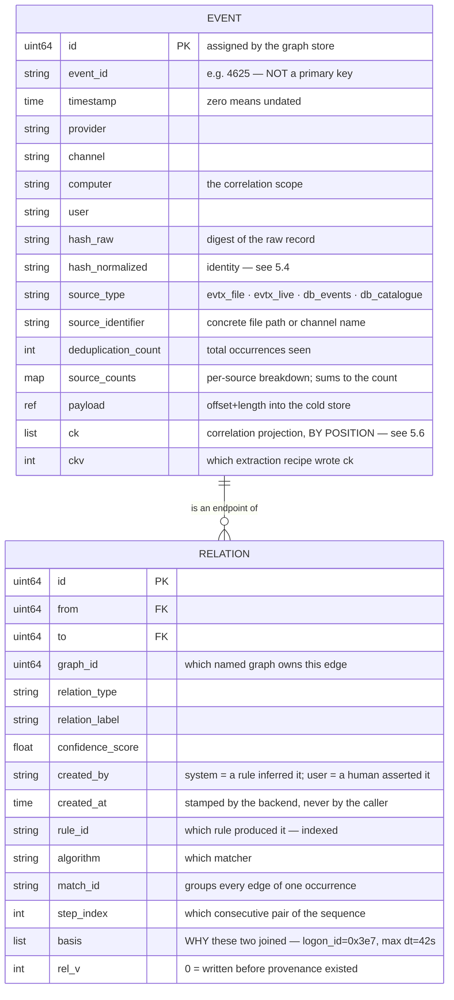

A note on naming that trips people up: **`event_id` is not an identifier of a
row.** It is the Windows event type number — `4625` means "failed logon", and
thousands of rows share it. The row's identifier is `id`.

### 5.2 What is indexed, and what deliberately is not

Each event registers **nine** secondary-index entries
([schema.go](backend/graphene/schema.go)):

| Indexed key       | Serves                                        |
| ----------------- | --------------------------------------------- |
| `event_id`        | exact-match filter                            |
| `timestamp`       | range filters (`>=`, `<=`, `between`)         |
| `provider`        | exact-match filter                            |
| `channel`         | exact-match filter                            |
| `user`            | exact-match filter                            |
| `computer`        | exact-match filter                            |
| `hash_normalized` | deduplication lookup — the hot ingest path    |
| `search_blob`     | substring search                              |
| `source_type`     | exact-match filter                            |

Each relation registers **four**: `relation_type`, `created_by`, `graph_id`, `rule_id`.

`rule_id` is the only piece of provenance that is indexed, and it earns it: it answers
"which edges did this rule produce" **without first knowing which graph they landed in**,
which is what the relationship inspector, rule-inertness reporting and orphan detection
after a rename all need. A rule's id is a slug of its name, so renaming strands the graph
it built — and the id stamped on the edges is then the only way back to them.

Several things are **not** indexed on purpose:

- **`source_identifier` and `deduplication_count`** — applied after decoding.
  They are rare filters, and every extra indexed key costs memory on every
  event, forever.
- **`raw_xml`** — excluded from `search_blob` explicitly, to keep the in-memory
  index bounded. Search covers the scalar fields, not the whole record.
- **`match_id`, and every correlation slot** — near-unique keys, which is exactly the
  shape that made store open 8.0 s instead of 0.8 s when the timestamp key was declared
  ordered (§5.3). Nothing queries by them: the inspector already holds the edges it needs,
  and correlation reads the whole matching set once per build and hashes it in memory.

### 5.3 The timestamp encoding, and a measurement that overrode the textbook

Timestamps are indexed as **fixed-width UTC text**:

```go
const TimestampIndexLayout = "2006-01-02T15:04:05.000000000Z07:00"
```

Fixed width plus a forced UTC offset means **byte order equals chronological
order**, which is what makes range comparisons in the index correct.

A zero timestamp renders as year one, so undated events sort before every real
record and are excluded by any lower time bound. Unix nanoseconds would be more
compact but are undefined outside 1678–2262, so a zero time would wrap to a
nonsense value rather than to "before everything".

Now the interesting part. The graph library supports **declaring a key ordered**,
which answers range queries by binary search instead of scanning. That is the
textbook move. It was implemented, measured, and **removed**:

```
timestamp declared     100k events: open ~8.0 s
timestamp undeclared   100k events: open ~0.8 s
```

A declaration is runtime state that does not survive a reopen, so it must absorb
every already-registered entry on **every** open — and for a near-unique key like
a timestamp, that absorption dominates startup and grows worse than linearly.
Meanwhile the queries it accelerates barely moved (narrow range 1.63–1.85 ms
declared vs 1.71–1.91 ms undeclared on 20k events), because **range queries in
rohy are dominated by decoding matched records, not by locating candidate ids**.

The lesson is written into [PERFORMANCE.md](PERFORMANCE.md) as the project's
first rule: measure rohy's paths, and measure **open**, not just the query.

### 5.4 Event identity — the hashing rules

Two hashes are computed per event, and they answer different questions.

| Hash              | Over what                                     | Answers                                    |
| ----------------- | --------------------------------------------- | ------------------------------------------ |
| `hash_raw`        | the raw record bytes                          | "are these byte-for-byte the same record?"  |
| `hash_normalized` | selected scalar fields, joined with `\x1f`    | "are these the same **occurrence**?"        |

`hash_normalized` is what deduplication uses, and it has **two branches**:

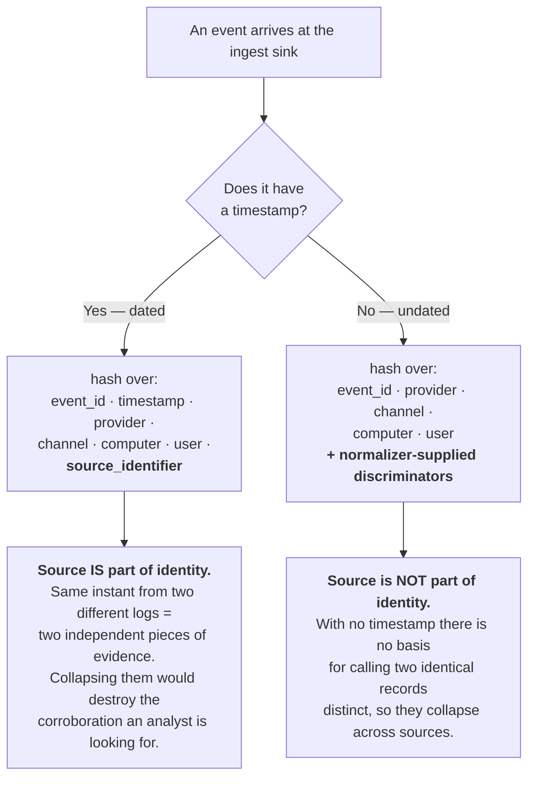

Why fields are joined with `\x1f` (ASCII unit separator) rather than a comma: a
control character **cannot occur in event text**, so field boundaries can never
collide by concatenation. Without it, `{"AB", "C"}` and `{"A", "BC"}` would hash
identically.

One subtlety that explains an odd-looking line in the pipeline: the per-record
normalizers do not know which file or channel the run is reading, so
`source_identifier` is stamped at the **sink**, and `ComputeNormalizedHash()` is
called again there — but **only for dated events**, because an undated event's
normalizer may have added discriminators the sink cannot see (a catalogue row's
message text) and must not drop.

### 5.5 The cold store — 70% of an event lives outside the graph

The graph database keeps its records **resident in memory**. Whatever is in an
event's property blob is loaded for every event in the case, forever. Measured
on a 40,000-event fixture with a 2 KB raw record:

```
topology only ........................  503 B/event
+ property index (9 keys) ............  867 B/event
+ raw record and parsed fields ....... 3137 B/event   ← 70% of the total
```

The raw record is read in **exactly one place**: when an analyst opens a single
event. Paying for it on every event, to serve a view of one, is the wrong trade.

So `RawXML` and `ParsedFields` are tagged `json:"-"` — excluded from the node
record — and written to an append-only log instead. The event keeps a `Ref`:
two integers standing in for kilobytes.

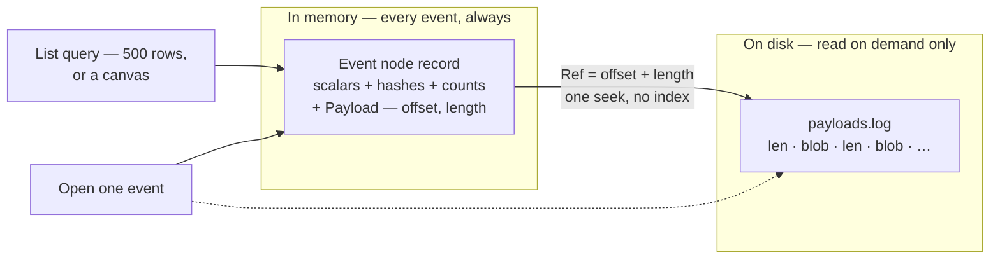

Design notes worth understanding:

- **The reference _is_ the index.** There is no lookup table to maintain.
- **Each record carries its own length header** (4 bytes) even though the `Ref`
  already knows it. This makes the log self-describing, so it can be walked and
  validated without the graph — which is what makes an orphaned tail after a
  crash *detectable* rather than silently misread.
- **Ordering under crash:** the payload is written and `Sync()`ed **before** the
  event referencing it is committed. A crash between the two leaves bytes nothing
  points at — wasted space, reclaimed by re-ingesting. The opposite order would
  leave an event pointing at a payload that was never written, which is
  unrecoverable. **Waste is the acceptable failure; dangling is not.**
- **Deleting an event does not reclaim its payload.** The log is append-only, so
  a delete would mean rewriting it. Space comes back by re-ingesting, which the
  project's pre-1.0 position explicitly allows.

### 5.6 The correlation projection — putting a dozen scalars back in

Section 5.5 is the story of getting bulk **out** of the node record. This one is the story of
putting a small, bounded piece of it back, and why that is not a contradiction.

v0.2.0 added matchers that correlate on EventData: a logon id, a process id, an account name
(§11). Those live in `ParsedFields`, which is in the cold store precisely because it is 70% of
an event's resident cost. But correlation needs them for **every event of every build**, and a
cold-store read per event per build would re-incur exactly the cost 5.5 removed — one seek and
one multi-kilobyte JSON decode, 100,000 times, to read a dozen bytes each.

So a **bounded, selected projection** is computed once at normalize time and stored in the node
record. Two properties make it affordable:

```go
// backend/consts — the vocabulary. Order IS the wire format.
var CorrelationSlots = []string{
    "logon_id", "subject_logon_id", "process_id", "new_process_id", "parent_process_id",
    "process_name", "target_user", "subject_user", "ip_address", "service_name",
    "dst_ip", "dst_port", "protocol", // v0.3.0, appended — recipe version 3
}
```

- **Values are stored by POSITION, not by name.** A map would repeat thirteen key names on every
  event forever. Measured: the same values keyed by name cost **+138 B/event** of pure
  vocabulary (at ten slots).
- **Each slot is bounded to its own domain**, not to one generous cap — identifiers 18 bytes
  ("0x" plus the 16 hex digits of a uint64), an image basename 40, an account 32, an address 39
  (the longest RFC 5952 IPv6 form, which canonicalization guarantees), a port 5, a protocol
  keyword 10.
- **Aliases are names, not slots.** `src_ip` resolves to the `ip_address` position
  (`consts.CorrelationSlotAliases`); it costs nothing on the wire and is served in the schema so
  every validator accepts it.

The budget was **measured, not chosen**, and the first measurement failed. A twelve-slot
vocabulary sharing a 64-byte cap cost **819 B/event** at the format's worst case, against a
483 B baseline node record — most of the way back to what 5.5 removed. The response was to
shrink the vocabulary, not to raise the ceiling: per-slot bounds, and two slots dropped
(`parent_process_name`, redundant with the other endpoint of a lineage edge;
`session_id`, subsumed by `logon_id`). At ten slots it cost **324 B worst case and 71 B on a
representative 4688** — about +8% typical against the 867 B/event baseline, to make field,
temporal and lineage correlation possible at all. The three network slots of v0.3.0 take the
worst case to **381 B** under the same 400 B ceiling; the typical 4688 is unchanged at 71 B,
because positions past the last filled slot are trimmed (PERFORMANCE.md §16).

`TestCorrelationProjectionBudget` fails the build if that number is exceeded, measuring the
**encoded node record** rather than the heap: the heap tests carry ~1000 B/event of GC noise,
comfortably more than the whole feature's allowance, so they could not have failed for the
reason the budget exists.

Two invariants worth knowing before touching it:

- 🔒 **`CorrelationSlots` is append-only.** Reordering or reusing a slot silently reinterprets
  every event already stored — a value written as a logon id read back as a process id, with
  nothing reporting an error. A vocabulary change bumps `CorrelationKeyVersion`, which makes
  existing events detectably stale.
- 🔒 **Absent is not empty.** Windows writes `-` and the null SID constantly; the extractor maps
  those to absent, and the field matcher **excludes** such events rather than bucketing them
  under `""`. Grouping them would correlate every event that happens not to carry the field with
  every other one — which does not look like a bug, it looks like a working rule.

Events ingested before the projection existed carry none, so field rules under-report against
them. That is surfaced, never silent: runs report `StaleCorrelationKeys`, and
`BackfillCorrelationKeys` fills them in — opt-in, resumable (each event carries the recipe
version it was written under), and idempotent. The binding then seals what it rewrote (§18.2).

---

## 6. What lives on disk

```
<working directory>/
└── rohy-data/                     ← beside wherever you launched the app
    ├── db/                        graph store — events, relations, indexes, WAL
    │   ├── payloads/
    │   │   └── payloads.log       append-only cold store
    │   ├── graphene.audit         the engine's audit log: who did what to the store (§18.5)
    │   ├── graphene.redactions    the engine's own redaction ledger (§18.4)
    │   └── graphene.checkpoints   the local checkpoint chain (§18.6)
    ├── graphs/registry.json       named graphs + which one is active
    ├── layout/canvas-<id>.json    node positions + viewport, one file per graph
    ├── rules/                     user rule files (*.json)
    │   └── rules-state.json       per-rule enabled/disabled overrides
    ├── capture/positions.json     per-channel live-capture bookmarks
    ├── findings/findings.json     analyst flags, tags and notes
    ├── snapshots/<graph>/<id>.json  a graph as it was at a moment (§14.5)
    ├── annotations/<graph>.json   notes, regions and arrows, in layers (§14.6)
    ├── redactions/journal.json    one entry per redaction; what must not come back (§18.4)
    ├── roots/                     the case-fingerprint history (§18.2)
    │   ├── roots.json             every root this case has had, and which were copied out
    │   └── receipts.json          where each checkpoint digest was published (§18.6)
    └── analysts/register.json     who has worked on the case, and their public keys (§18.5)

<user config directory>/rohy/analyst.json   the analyst's own profile — follows the
                                            analyst, not the case
```

The three `graphene.*` files belong to the engine, and rohy appends to them only
through it. It reads them to check that their last record is whole. When the
tail of `graphene.audit` or `graphene.checkpoints` is torn, rohy copies that
tail aside (`<file>.torn-<UTC time>`) and cuts the file back to its last whole
record itself; that is the one place it changes an engine file. Apart from its
own payload log under `db/payloads/`, those torn-tail copies, and the analyst
profile in the user config directory, every rohy-owned file sits in a directory
beside `db/`.

Two deliberate choices:

**Data sits beside the launch directory, not in `%APPDATA%`.** A working folder
is therefore self-contained and portable — copy the folder, carry the case.

**Everything that is _not_ evidence is a sidecar.** Layout is UI state; enabled
flags are preferences; findings are opinions; bookmarks are progress. None of
them belong inside the evidence store, and all of them are plain readable JSON.
The findings package states the reason explicitly: an analyst's notes may outlive
this program, and they should not need it to be read back.

---

## 7. Ingestion

This is the most involved subsystem. It has three sources, one shared pipeline,
and a set of ordering rules that make it crash-safe.

### 7.1 The shape: producer → workers → sink

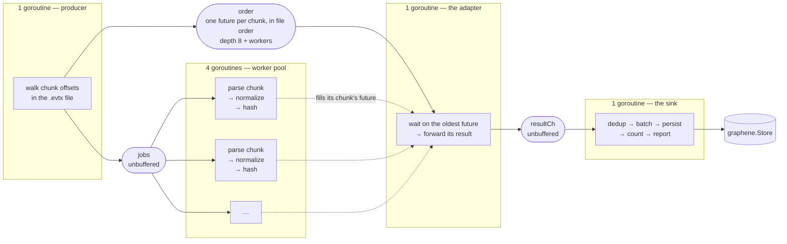

Why this shape:

- **Parsing is CPU-bound and parallel.** Each worker opens its **own file
  handle**, because parsing seeks the handle and a shared one would race.
- **Persisting is single-goroutine.** Everything funnels through one sink, so
  the counters and the `Reporter` need **no synchronisation at all**. That is not
  laziness — it is a deliberate trade of a little throughput for the complete
  absence of a class of bug.
- **Chunks reach the sink in file order** 🔒, whichever worker finishes first.
  Node ids are assigned in the order events reach the store, and the rule engine
  orders events at the same instant by node id (§11.4). Handed over as workers
  finished, the same file got different ids on every ingest, so two events at one
  instant could be joined on one ingest and not the next, and an idempotent
  ingest kept whichever copy of a duplicate arrived first. Each chunk gets a
  *future*, a channel of capacity one its worker fills exactly once; the producer
  queues the futures in file order before handing the chunk out, and the adapter
  forwards their results in that order. A worker never waits on anything but its
  next job, so the oldest chunk always finishes and nothing deadlocks behind it.
  The `.db` reader is one ordered producer already; live capture interleaves its
  channels as records arrive, which is inherent.
- **The window is bounded.** A chunk is handed out only once its future has a
  place in `order`, so at most `ChunkQueueDepth + workers` (12) chunks are parsed
  ahead of the oldest one the sink has not taken. When the sink falls behind or is
  paused, the adapter blocks, `order` fills and the producer stops. This is
  backpressure, and it is what makes **peak memory independent of input size**,
  whether the file is 5 MB or 5 GB (`TestBoundedMemoryStreaming`, and
  `TestTheReorderWindowBoundsWhatIsParsedAhead` with the oldest chunk stuck).
- **The evidence handles are closed before `Ingest` returns**, on every path,
  cancel and failure included: on Windows an open handle keeps the file from being
  moved or deleted. The handle that validated the file is the first worker's, so a
  run always has one; an extra handle that cannot be opened is reported and the
  run goes on with fewer workers.

Tuning constants ([consts.go](backend/consts/consts.go)):

| Constant           | Value | Role                                                  |
| ------------------ | ----- | ----------------------------------------------------- |
| `ParseWorkerCount` | 4     | parse/normalize concurrency                           |
| `ChunkQueueDepth`  | 8     | with the worker count, the reorder window             |
| `EventBatchSize`   | 512   | events per durable write                              |
| `ProgressInterval` | 2000  | records between progress emissions                    |

### 7.2 Deduplication — a three-way decision per event

When `Idempotent` is on, every event hits this decision at the sink:

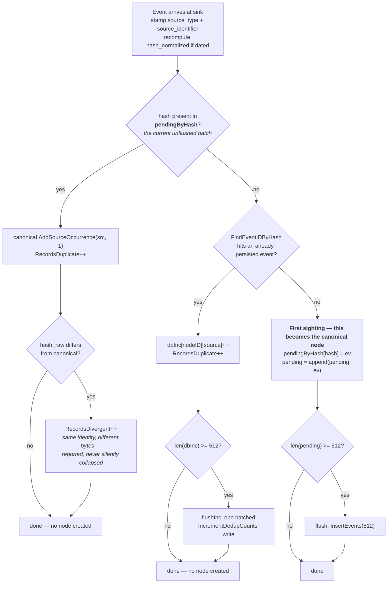

Two details that are easy to miss:

- **`pendingByHash` is cleared on every flush.** Once a batch is persisted, its
  canonicals are in the database, so later duplicates must go through the
  database path. Keeping the map would grow unboundedly and, worse, would let a
  later duplicate increment an in-memory object nobody will write again.
- **`RecordsDivergent`** exists because identity deliberately excludes the raw
  payload. If two records match on identity but differ in bytes, the rule cannot
  tell them apart — but that might be wrong. It is counted and reported rather
  than hidden. It is only detected **within a batch**, where the canonical is
  still in memory; checking against already-persisted events would cost a fetch
  per duplicate.

### 7.3 Batching, and why it is the whole performance story

Every commit must reach the write-ahead log before it returns. That is what
crash-safety costs, and it is not tunable. So:

> **In rohy's write paths, the number of durable commits dominates. Property
> encoding does not. Ingest is write-bound, not CPU-bound.**

This single fact explains several otherwise-odd pieces of code:

- `InsertEvents` takes a **slice**, not one event.
- `AppendBatch` frames many payloads into **one buffer, one write**, rather than
  a syscall per record.
- `IncrementDedupCounts` takes a **map of deltas**, reads every node in one
  batched fetch, and commits all increments in a single transaction. Applied one
  at a time this was a durable write per duplicate — the dominant cost of a
  duplicate-heavy ingest.
- `InsertRelations` (used by rule builds) writes a whole chunk in one commit.

### 7.4 Pause, and the bookmark ordering rule

Live capture can be paused. Pausing does **not** abandon work — and the ordering
around it is the most safety-critical logic in the pipeline.

The rule is one sentence:

> **A capture position is only ever written AFTER the events up to it are
> durably persisted.**

A crash therefore re-reads a little, which hash idempotency collapses to nothing.
It can never **skip**.

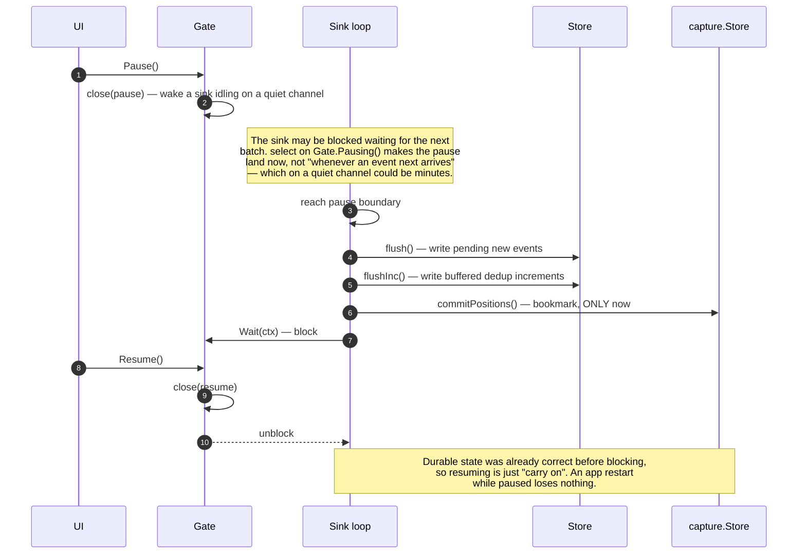

`commitPositions` has a guard that repays careful reading:

```go
if opts.Positions == nil || len(staged) == 0 || len(pending) > 0 || len(dbInc) > 0 {
    return
}
```

It refuses to bookmark while **either** buffer holds unwritten work. Guarding
only `pending` would let a flush advance the bookmark past a record whose
duplicate's increment is still buffered from an earlier chunk. That is not event
loss — but it is a durable write escaping its bookmark, which is exactly what
this discipline exists to prevent.

### 7.5 Three sources, one pipeline

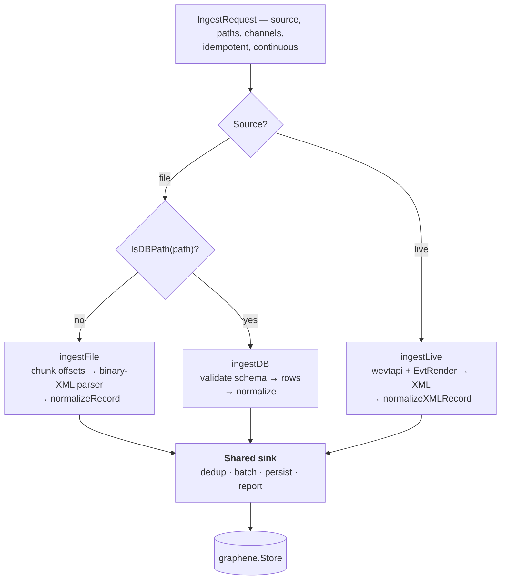

**`.evtx` files.** Parsed with the Velocidex library, which emits ordered JSON
dicts rather than reconstructed XML — so the stored raw payload is that JSON
serialization. Timestamps come from the record header as Windows FILETIME
(100-nanosecond ticks since 1601) and are converted with a fixed epoch offset.

**SQLite `.db`.** Two documented shapes only — an `events` table, or a
`messages`/`providers` catalogue. There is **no schema sniffing**, and the
comment in [dbsource.go](backend/dbsource/dbsource.go) states why: mis-mapping
columns would silently corrupt forensic evidence, which is worse than refusing
the file. A database matching neither is rejected with a message naming both
shapes it checked. Catalogue rows have no timestamp, so they are the primary
source of **undated** events.

**Live Windows Event Log.** Uses the native `wevtapi` (Windows only; the build
uses `_windows.go` / `_other.go` file suffixes so other platforms compile a stub).
Records come back as XML via `EvtRender`, so there is a second normalizer —
[evtx_xml_normalize.go](backend/evtx/evtx_xml_normalize.go). Critically, it
hashes over **the same ordered fields** as the file normalizer, so the same
event ingested from a file and from the live log produces the **same**
`hash_normalized`. That is what makes cross-source dedup work at all, and it is
unit-tested without a running event log.

---

## 8. Reading events — the query path

The naive read path answered **one page** by hydrating every matching event — a
full JSON decode per node, multi-kilobyte raw payload included — purely to learn
each event's timestamp so the set could be sorted. Progressive loading then
repeated that entire scan for every page the user scrolled to.

Two changes fix it, and together they are the reason the events list stays usable
on a large case.

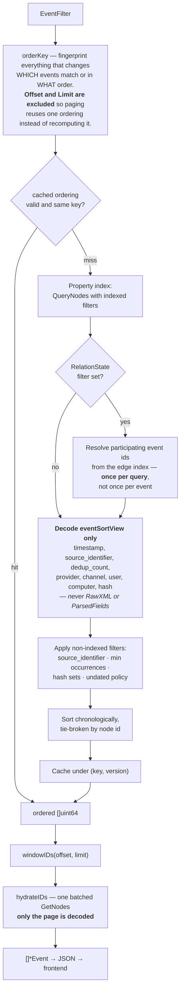

### 8.1 Cache invalidation is a counter, not a guess

```go
func (s *Store) bumpVersion() {
    s.order.version++
    s.order.valid = false
    s.order.ids = nil
}
```

Every write path calls it via `defer` — including relation writes, because the
relation-state filter selects events by their edges. And `storeOrder` refuses to
cache a result computed against a version that has since moved:

```go
if s.order.version != version { return }  // a write landed mid-computation
```

That is what makes a stale ordering impossible rather than merely unlikely.

### 8.2 Sorting undated events

```go
zi, zj := rows[i].ts.IsZero(), rows[j].ts.IsZero()
if zi != zj { return zj }        // a dated event always precedes an undated one
if zi { return rows[i].id < rows[j].id }
```

Undated events sort to the **end regardless of direction**. Letting the zero time
order them would park them at "1970" — ahead of every real record when ascending
— which reads as *a date* rather than as *the absence of one*.

### 8.3 Counting has a fast path

`CountEvents` returns `len(ids)` straight from the index — reading **no node
payload at all** — but only when no filter needs a decode to evaluate:

```go
if f.SourceIdentifier == "" && f.MinDuplicateCount == 0 &&
   f.RelationState == "" && f.Undated == consts.UndatedInclude {
```

The undated condition is in that list because the policy is decided per event
from the timestamp, which the index count cannot see. Skipping it would report a
total that includes rows the list hides — and "showing 500 of 12,000" would be a
lie. Otherwise the count reuses **the same ordering the list pages from**, so the
count and the list can never disagree about what matches.

### 8.4 Findings reach the query without the store knowing what a finding is

The persistence layer has no concept of a flag or a tag. Instead, `EventFilter`
exposes `HashIn` / `HashNotIn` — sets of content hashes. The API layer resolves
"show me flagged events" against the findings sidecar into a hash set, and
`graphene` just matches hashes.

The nil-versus-empty distinction is load-bearing and documented in the source:

- `nil` map → **no filtering**.
- non-nil **empty** map → **nothing matches**, which is the correct answer for
  "show flagged events" in a case where nothing has been flagged yet.

Because of that, the order-cache key fingerprints the sets **exactly** (sorted
and joined, not digested): a collision would silently serve the wrong events.
The sets are analyst-authored, so their size tracks how much has been annotated,
not how large the case is.

---

## 9. Timeline

A case can hold hundreds of thousands of events. Shipping them all to the
frontend to be drawn is not an option. So the backend answers with a **density
histogram** — the time extent plus per-bucket counts — and the page fetches
individual events only for the narrow range the user has zoomed into.

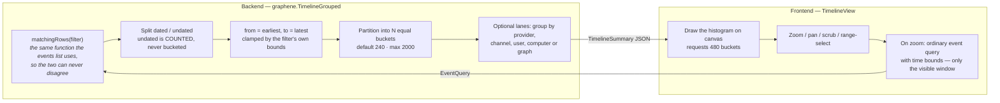

Details worth knowing:

- **Lane counts travel as a bare `[]int`** aligned index-for-index with the
  bucket list, rather than repeating bucket boundaries per lane. With many lanes
  that is the difference between a small payload and a silly one.
- **Lanes are capped**, and beyond the cap the smallest fold into a single
  `other` row. A timeline with four hundred lanes is unreadable and the payload
  is wasted.
- **Degenerate spans are handled truthfully.** If every event shares one instant,
  the result is a single bucket — not identical timestamps spread across a
  fabricated range.
- **Graph lanes are resolved in the frontend.** The backend returns graph *ids*,
  because the persistence layer has no notion of graph names; the registry lives
  outside it.

---

## 10. The rules engine

### 10.1 The format

One file, one rule, one graph:

```json
{
  "format_version": 1,
  "name": "Failed Logons Then Successful Logon",
  "description": "Three failed logons followed by a success on the same computer.",
  "relation_type": "correlation",
  "algorithm": "sequence",
  "sequence": ["4625", "4625", "4625", "4624"],
  "labels": ["", "", "then succeeds"]
}
```

A rule selecting one of the other three algorithms adds the fields that matcher reads —
`match_fields`, `window_within`, `lineage_create_ids` — and the guided form shows only those,
because offering controls an algorithm ignores invites an author to fill in fields that do
nothing. [RULES.md](RULES.md) is the authority on every field; §7 there lists the algorithms
and §8 states what a match of each one **establishes**, which is the distinction that decides
how much weight a graph deserves.

`labels[i]` names the edge between `sequence[i]` and `sequence[i+1]`. An empty
entry — or a missing tail — is an untagged connection, so a rule may label only
some of its links.

**A rule's `id` is a slug of its `name`.** This has a consequence that surprises
people and is handled explicitly in [save.go](backend/rules/save.go): renaming a
rule does not edit it, it *replaces* it with a different rule, and a graph built
under the old id stops resolving. `Save` therefore reports what it actually did
rather than leaving the UI to guess.

### 10.2 The registry: builtins and user rules merged

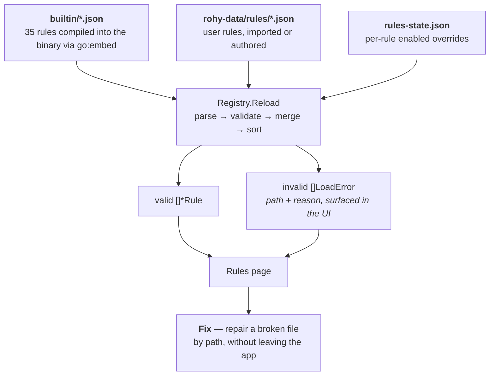

- A **user rule may override a builtin** of the same id — builtin names are not
  in the "claimed" set when checking for import collisions.
- **Import never silently replaces** an existing user rule; a collision is a
  rejection with a reason, and the file is left where it was.
- **Builtins cannot be edited in place.** _Duplicate_ makes an editable copy.
- A file that fails to load still appears, addressed **by path**, so it can be
  repaired. `ReadFile` confines that path to the rules directory — a binding that
  reads a file must not be talkable into reading an arbitrary one.

### 10.3 One validator, three consumers

Validation could easily have been written three times: once in the loader, once
in the guided form, once in the raw editor's squiggles. [validate.go](backend/rules/validate.go)
refuses that:

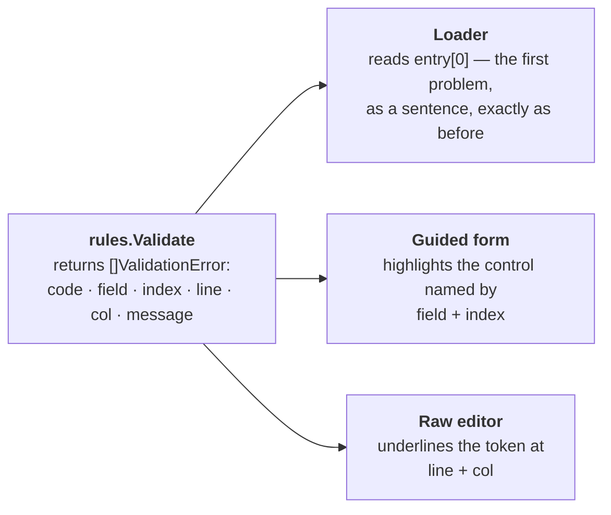

Line and column are 1-based and **counted in runes**, so a description with
non-ASCII characters does not shift the caret. Both are `0` when a problem cannot
be located — a field absent from the file has no position in it.

Outside the application the same function has two more readers. `rohyctl validate`
calls `ValidateSource` and prints each problem as `file:line:col`; with `--json`
it prints them as one report for a program to place. The VS Code extension in
[tools/vscode-rohy](tools/vscode-rohy/README.md) is that program: it sends the
buffer on stdin as it is typed and underlines what comes back. It is a reader,
not a fourth validator. When `rohyctl` is absent it falls back to the generated
JSON Schema and says so in the status bar, because the schema cannot express what
depends on the algorithm.

Two details of that boundary are easy to get wrong:

- **Columns are runes; VS Code counts UTF-16 units.** A character outside the
  Basic Multilingual Plane is one of the first and two of the second, so the
  extension walks the line character by character rather than adding the column
  to the line's start.
- **Lines are counted by `\n` only.** VS Code also breaks at a lone `\r`. The
  extension turns a problem into a text offset and lets the document convert it,
  so the two never count lines differently.

The report is a contract with its own version (`output_version`). The rules in
`tools/vscode-rohy/test/fixtures/rules` and the reports beside them are read by
both test suites: Go pins what `rohyctl` prints, and the extension places those
exact reports on those rules.

Alongside it, [schema.go](backend/rules/schema.go) describes the format **as
data**: every field's prose, kind, allowed values and bounds, derived from the
same constants the validator reads and served to the frontend over a binding. The
guided form's controls, the raw editor's completion list, and the client-side
pre-validation are all *generated* from that one descriptor. A reflection test
asserts every exported `Spec` field appears there — so a new field cannot be
added to the format without being documented for the people who have to write it.

### 10.4 Formatting operates on bytes, never on structs

`Pretty` and `Minify` work on **raw bytes**. Round-tripping through `Spec` would
be far less code and would quietly destroy the two things the format promises to
keep: **field order**, and **any field this build does not interpret**.

Pressing "Pretty" on a rule written for a newer rohy must not delete the fields
that make it work. So the formatter decodes into an order-preserving tree and
re-renders it in the house style — one field per line, short arrays kept on one
line, because a sequence reads as a sequence when its steps sit side by side.

---

## 11. The correlation engine

`autograph` is a **pure function**: rule spec + events in, unpersisted relations
out. It never writes. That is what makes it testable in isolation and safe to
reason about.

### 11.1 The sequence algorithm, step by step

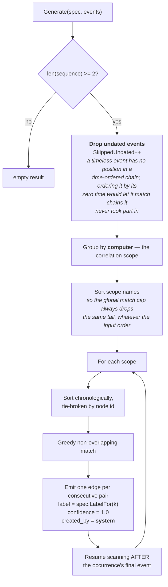

### 11.2 A worked example

Rule: `["4625", "4625", "4624"]`. Events on computer `WS1`, already sorted:

| index | event_id | note                   |
| ----- | -------- | ---------------------- |
| 0     | 4625     |                        |
| 1     | 4672     | not in the sequence    |
| 2     | 4625     |                        |
| 3     | 4624     |                        |
| 4     | 4625     |                        |
| 5     | 4625     |                        |
| 6     | 4624     |                        |

- **Scan from 0** → matches indices `[0, 2, 3]`. Index 1 is simply skipped: the
  steps do **not** have to be adjacent. Emits edges `0→2` and `2→3`.
- **Resume at 4** (one past the match's last index — this is the non-overlapping
  rule). Matches `[4, 5, 6]`. Emits `4→5` and `5→6`.
- **Resume at 7**; `7 + 3 > 7`, loop ends.

Result: **2 matches, 4 relations.**

### 11.3 Cost

Because each successful match resumes strictly after the previous one, the
scanned segments are **disjoint**. Total scanning work per scope is therefore
linear in the number of events, plus at most one failed scan:

```
per rule:  O(E log E)   sorting   +   O(E)   matching
per run:   the dataset is read ONCE and shared by every rule
```

There is no backtracking and no combinatorial explosion — which is precisely why
the greedy formulation was chosen over "find all subsequences".

### 11.4 Determinism and the cap

Implementations must be **pure and deterministic**: same inputs, same output,
independent of map iteration order or the wall clock. Hence sorted scope names
and id tie-breaks everywhere.

The id tie-break makes node ids an input, so they must be deterministic too. A
file ingest writes its chunks in file order (§7.1), so the same file read into a
fresh case gets the same ids, and therefore the same graph and the same match
ids (`TestTheSameFileGivesTheSameCaseEveryTime` in `backend/integration`). Within
one file, ties then follow the order the log recorded them. Across **several**
files, ids follow the order the analyst ingested them: the same files ingested in
another order can resolve a tie between two files differently. A tie-break on
content was rejected: an event's identity includes its source path, so the order
would change with the folder the evidence was read from, and the graph would
order ties differently from the timeline, which pages by id.

`AutoGraphMaxMatches = 100000` caps completed matches. On hitting it, the scan
**keeps going** — but only to count how many more it is dropping, so the result
reports `Truncated: true` and an exact `Dropped` figure. Silent truncation is
never acceptable.

### 11.5 The prepared dataset — one sort per build, not one per rule

Every algorithm needs the same three things done first: undated events dropped, events grouped
by scope, each group sorted chronologically. Each rule used to do all three itself, so a build
of twenty rules sorted the same case twenty times.

`autograph.Prepare` does it once and hands every rule the result:

```go
func Prepare(events []*graphene.Event, need Requirements) *Dataset
func GenerateWith(spec *rules.Spec, ds *Dataset) Result
```

Three properties, each load-bearing:

- **Built to requirements.** `Requirements` is the union of what the *selected* rules read, so
  a build of sequence-only rules pays nothing for machinery it will not touch.
- **Immutable after construction.** There is no lazy memoization of partitions computed on
  first use — a mutable structure shared across rules is a data race the moment anything
  evaluates two rules concurrently, and the purity of this package is what makes the testbench
  (§11.7) a safe thing to offer at all.
- **Partitions inherit the global sort.** They are built by a stable pass over the
  already-sorted slice, so every partition is chronological without being sorted. Preparation is
  one `O(n log n)` sort plus `O(n)` per scope, not a sort per group.

Measured at 50k events, mixed algorithms — `BenchmarkBuild` against
`BenchmarkBuildPreparingPerRule`, the v0.1.0 shape kept as the comparison:

| Rules | Shared prepare | Per-rule prepare | Allocated |
| ----: | -------------: | ---------------: | --------- |
|     1 |        28.0 ms |          26.8 ms | 2.1 → 2.1 MB |
|     5 |        86.0 ms |         154.6 ms | 4.9 → 13.3 MB |
|    20 |         282 ms |           505 ms | 16.2 → **56.1 MB** |

Medians of three runs at `-benchtime=20x`; the timing spread is ~±10%, the allocation figures
are stable to the byte. Per **rule**: 28.0 → 17.2 → 14.1 ms as the count rises, against a flat
26.8 → 30.9 → 25.2 ms. The falling curve *is* the shared sort. At one rule they are identical,
exactly as they should be — there is one prepare either way.

### 11.6 Four algorithms, and what each one lets you claim

The registry is the whole extension point, and it now holds four:

```go
var registry = map[string]Algorithm{
    consts.AlgoSequence: sequenceAlgorithm{},
    consts.AlgoField:    fieldAlgorithm{},
    consts.AlgoTemporal: temporalAlgorithm{},
    consts.AlgoLineage:  lineageAlgorithm{},
}
```

🔒 A test asserts the registry and `consts.Algorithms` agree **in both directions**. Without it,
a name accepted at load with no implementation behind it would build an empty graph and look
exactly like a rule that found nothing — the validator refuses unknown names, which is also why
adding an algorithm needs no format-version bump (RULES.md §5).

The differences that matter are not in what they find but in what a match **establishes**
(RULES.md §8). Three implementation notes that are easy to get wrong:

**`field` excludes rather than buckets.** An event carrying no value for a required field is
left out and counted, never grouped under `""` — see 5.6. Buckets inherit chronological order
from the dataset, so there is no per-bucket sort anywhere in the algorithm.

**`temporal` is a sweep, not greedy-with-a-time-check.** Greedy takes the *earliest*
subsequence, which is correct when order is the only constraint. Add a window and it is not:
given `A@00:00, A@10:00, B@10:30` with a one-minute window, greedy anchors on the first `A`,
finds `B` 10m30s later, rejects — and has already walked past a valid match. Abandoning the
partition drops real matches; restarting from every failed anchor is quadratic on a log where
the anchor event is common. So it sweeps once, keeping the **most recent** event that completed
each step, which is provably sufficient: a later completion has a larger timestamp and so
satisfies the window for strictly more future events. The consequence to know is that temporal
is **latest-anchored** where sequence is **earliest-anchored**; with an unbounded window the two
would not always emit the same edges.

**`lineage` resolves parents through time, not by PID.** Windows reuses process IDs
aggressively — a busy host cycles the space in hours — so joining on the parent PID over a case
spanning days produces a confidently wrong graph in which every wrong edge looks exactly like a
right one. Each creation opens a lifetime interval for its PID, closed by that PID's next
creation or by its exit (4689); a child's parent is the process whose interval **contained** the
child's creation time. Where no interval contains it — usually because the parent predates the
log — nothing is emitted and `UnresolvedParents` is reported. Nothing is guessed.

### 11.7 Provenance, and why the testbench is ~100 lines

Every edge a rule writes now records **which rule, which occurrence, which step, and on what
grounds**:

```go
rel.StampProvenance(ruleID, algorithm, matchID, stepIndex, []string{"logon_id=0x3e7"})
```

`MatchID` is **derived, never generated** — a digest of the occurrence's own endpoints and
length. A random or counter-based id would change on every rebuild, which would defeat the
idempotency the build workflow is designed around and make two builds of one case
incomparable. `Basis` is what turns "inferred, not asserted" from a colour on the canvas into
a claim an analyst can check.

And because `autograph` returns **unpersisted** relations and cannot write, "try this rule
without committing to it" needs no sandbox, no transaction to roll back, and no second
evaluation path that might diverge from the real one. `graphbuild.DryRun` is the same call the
build makes with the persistence simply not done — and `TestDryRunWritesNothing` asserts
relations, events *and* graphs are all unchanged afterwards, because the claim is not "it
usually does not persist" but "the path contains no write".

---

## 12. Graph build — where rules become persisted graphs

`graphbuild` is the only place rules, events, the engine and persistence meet.
The contract is **one rule = one graph, N rules = N graphs**, and rebuilds are
idempotent by construction.

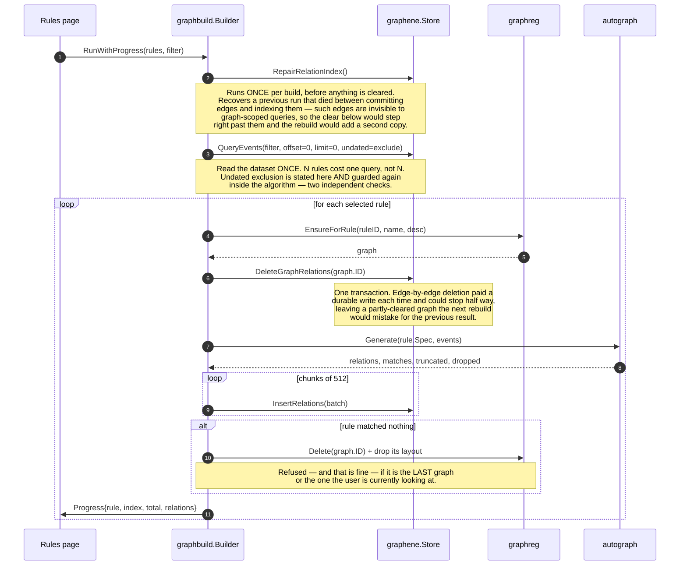

Three decisions worth understanding:

**Repair before clear.** A relation whose index entry was never registered still
shows up in adjacency (adjacency reads incident edges directly) but is invisible
to graph-scoped queries (those resolve through the `graph_id` index). Structural
verification cannot catch this — the edge and its adjacency agree, so nothing is
*damaged*; a caller-encoded value simply was never written. Only `graphene`
knows how a relation encodes its own index entries, so repair lives there and is
called here. The engine registers a relation's entries one write-ahead record per
key, so a crash can also leave an edge its graph lists and its rule does not; the
repair, and the integrity count beside it, check **every** key a relation is
indexed under, not only `graph_id`.

**Empty graphs are discarded.** Keeping them would fill the graph picker with one
empty entry per rule that did not fire, and an empty graph looks exactly like one
whose results have not loaded yet. "This rule found nothing" is better said by the
run outcome, which reports zero matches. It also makes rebuilds **symmetric**: a
rule that used to match and now does not gets its graph cleared *and* removed,
rather than left as a husk of a result that is no longer true.

**Progress is per rule, not sub-rule.** A rule is the smallest unit whose result
is meaningful. Inventing intra-rule percentages would be precision the workflow
does not have.

---

## 13. Findings — the one layer authored by a person

Everything else in rohy is machine-derived: events come from EVTX, edges come
from rules, layout comes from an algorithm. Findings are the exception, and the
design follows from that.

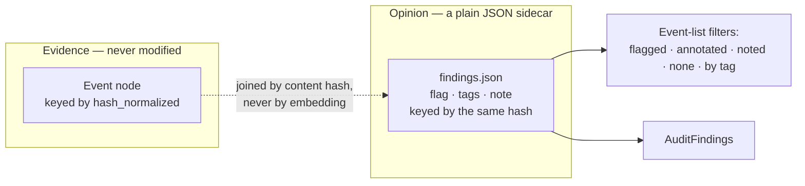

- **Keyed by content hash, not node id.** Node ids are assigned by the store; a
  content hash survives a re-ingest.
- **Bounded**: a note holds at most 8000 characters and a tag 64 (a longer tag is
  cut between characters and trimmed, never refused), with at most 32 tags. A
  character is a code point: Go counts runes, and the editor counts code points
  through `noteTooLong` in [lib/findings.js](frontend/src/lib/findings.js) (a
  `for…of` walk, the count `[...s].length` gives). It reads `.length`, which
  counts UTF-16 units, only as a shortcut, because that length is never less
  than the code-point count. The frontend knows the same limits from consts, so the editor
  warns *before* a write is refused rather than after.
  [backend/findings/testdata/note-limit-cases.json](backend/findings/testdata/note-limit-cases.json)
  holds both sides to one set of cases, and `lib/consts/limits.test.js` holds the
  mirrored values to `consts.go`. The tag input's `maxlength` is only a typing
  aid; the backend's cut is the backstop.
- **A failed write changes nothing.** `Set` and `Remove` put back the one finding
  they touched when the write fails, so the screen never runs ahead of the disk
  (`TestAFailedSetChangesNothing`, `TestAFailedRemoveKeepsTheFinding`).
- **Debounced saves** (600 ms) with a flush on blur, so typing does not rewrite
  the sidecar on every keystroke and nothing is lost.

### The audit, and why orphans are never auto-deleted

Findings outlive the events they describe. Clear the store, ingest a different
dataset into the same folder, and every previous finding is still on disk keyed
to hashes no event can produce. Queries stay correct — a phantom hash matches
nothing — but the counts would claim work that is not there.

`AuditFindings` reconciles the two and reports `Total`, `Live`, `Orphans`, plus a
`Stale` flag meaning "the sidecar was written against a different hashing recipe
than this build produces" — in which case **every** finding orphans at once and
the cause is the build, not the data. That distinction has to be drawable by the
UI.

Orphans are **reported, never deleted**. Re-ingesting the missing source brings
the events back and the findings reattach. Deleting them would destroy
irreplaceable analyst work to tidy a number.

---

## 14. Named graphs and canvas layout

Two small sidecars, kept deliberately separate from each other and from the store:

| Package    | Owns                                              | Explicitly does **not** own            |
| ---------- | ------------------------------------------------- | -------------------------------------- |
| `graphreg` | graph id, name, description, timestamps, active   | relations (those live in the store)    |
| `layout`   | node x/y positions, viewport pan/zoom, per graph  | anything about what an event *is*      |

`Graph.RuleID` binds a graph to the rule that produces it and **survives
renaming**, so a rebuild always finds its own graph even after the analyst has
renamed it.

Two refusals are deliberate, and neither is an error:

- **The last graph cannot be deleted.** The application always needs somewhere to
  put a hand-drawn relation.
- **The graph currently being viewed is never auto-deleted.** Removing the active
  view out from under someone mid-investigation is worse than leaving one empty
  graph in the list.

The startup migration folds pre-multi-graph data forward: relations with no
`graph_id` are assigned to `Default`, and a legacy `canvas.json` is moved to that
graph's per-graph file. Every step is idempotent, which is what makes it safe to
run on **every** startup rather than gating it behind a version flag.

**Deleting an event prunes every layout, and nothing else.** `GraphAPI.DeleteEvent` removes the
event from the store first, then from every graph's saved canvas (`layout.Store.RemoveNode`, a walk
of the `canvas-<n>.json` files). A file that does not hold the id is not rewritten. Snapshots,
annotations and findings keep their entries. The reasons differ:

- A layout is canvas membership keyed by **node id**, and the store never reuses an id, so an entry
  for a deleted event can never name anything again. Left in place, it is an id every reader of
  that canvas must step over.
- Snapshots, annotations and findings are keyed by **hash** and are the analyst's record. They
  reattach if the event is ingested again, and each already reports an entry it cannot place.

The store goes first because a crash between the two steps then leaves a canvas that names a gone
event, which every canvas read skips (§14.1). The other order could leave an event in the case that
its canvases no longer show.

**A damaged canvas is moved aside, and the delete carries on.** A `canvas-<n>.json` that is read but
does not decode as a canvas, an empty file included, is renamed to
`canvas-<n>.json.unreadable-<UTC>` (`consts.CanvasKeptInfix`, the same infix a fingerprint history
kept aside uses), kept byte for byte, and never written over: a second kept file in the same second
takes a numbered name. `DeleteEvent` returns it in `DeleteEventResult.set_aside`, and the canvas
says where it went in a warning that stays until dismissed. Moving it loses nothing: no reader could
use it, and its graph opened without saved positions anyway; after the move the graph opens empty
and can be saved again. Before this, one damaged file failed every later delete.

A canvas that could not be **read** (an I/O error, not a decode error) or could not be moved or
written is left alone, because a failed read says nothing about the file. It does not stop the walk:
every other canvas is still pruned, and `DeleteEvent` returns `persistence_error` with
`event <id> was deleted, but not every saved canvas could be updated:` and each failing file. The
message gives no retry advice, because whether a retry helps depends on the file. Deleting the same
event again runs the prune again, although the store no longer holds it
(`TestDeleteEventRemovesItFromEveryCanvas`, `TestDeletingAGoneEventAgainFinishesThePrune`,
`TestDeleteEventSetsADamagedCanvasAsideAndCarriesOn`, and in `layout`
`TestRemoveNodeSetsADamagedCanvasAsideAndCarriesOn`, `TestRemoveNodeNeverSetsACanvasAsideOverAKeptOne`,
`TestRemoveNodeReportsACanvasItCouldNotSetAsideAndStillPrunesTheRest`).

The case check reports both: a damaged canvas still in place, and every canvas already moved aside
(`layout.Survey`, detector 7).

🔒 One mutex in `layout.Store` covers `Save`, `Load`, `Delete`, `RemoveNode` and `MigrateLegacy`, so a
*Save layout* cannot land between `RemoveNode`'s read and its write and be undone. `Load` takes it
too: on Windows a file another handle holds open cannot be renamed over, and a file in the middle of
that rename cannot be opened (`TestConcurrentSaveAndRemoveNodeLeaveAReadableCanvas`).

### 14.1 Auto-layout profiles

**What it does.** The *Arrange* panel on the Graph page moves the cards in the graph's canvas
membership into one of four arrangements, called *profiles*. Membership is the layout sidecar as
last saved, or every linked card if no layout has been saved yet, so a card placed since the last
save is not moved until the layout is saved again. Each profile answers a different question. The analyst
previews a profile first; *Keep* saves it, and *Put back* returns every card to where it was.

| Profile (`consts`)   | Picker label | x is…                                                    | y is…                                           | Reads                         | Caveat it reports in `Note`            |
| -------------------- | ------------ | -------------------------------------------------------- | ----------------------------------------------- | ----------------------------- | -------------------------------------- |
| `sequence` (default) | Sequence     | step in the chain                                        | time order within the step                      | edges, timestamps             | a placement had to be forced (the graph has a cycle) |
| `lineage`            | Lineage      | tree column, each parent centred over its children       | depth in the tree                               | edges, timestamps             | a tree's root had to be forced         |
| `resource`           | Resource     | one column per value of a chosen correlation field (§5.6) | time order in the column                        | correlation keys, timestamps (never edges) | events that do not record the field    |
| `temporal`           | Time         | real time, stretched over `LayoutTemporalSpan`           | a *lane*: a row shared by cards that do not overlap | timestamps only           | events with no timestamp               |

**How it works.** The work is split across three layers, and only the last one ever writes.

1. **[backend/graphlayout](backend/graphlayout/graphlayout.go) is pure.** Node metadata and
   relations go in; coordinates come out. It opens nothing, reads nothing and writes nothing. It
   sees each event as a small `NodeInfo` (id, timestamp, a `Dated` flag, correlation keys, a short
   label), never as a full store record.
2. **`GraphAPI.ComputeLayout`** ([backend/api/api_layout.go](backend/api/api_layout.go)) collects
   the input: the graph's relations and its *canvas membership*, which is the set of node ids in
   the layout sidecar (§14). Before any sidecar exists, as right after a rule build, it uses the
   relations' endpoints instead. It reads those events' stored records with `GetEventRecords`: one
   batched node read, with no cold store, that leaves out any id the case no longer holds. It then
   calls `graphlayout.Compute` and returns the result. It saves nothing.
3. **The frontend** ([AutoLayoutPanel.svelte](frontend/src/components/graph/AutoLayoutPanel.svelte),
   [lib/graph/autolayout.js](frontend/src/lib/graph/autolayout.js)) moves the cards in memory with
   the graph store's `applyLayout`. Only *Keep* calls `saveLayout`, which writes the sidecar.

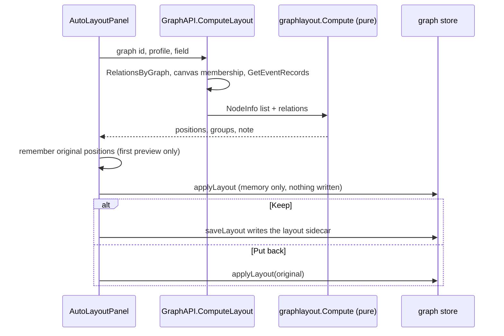

Inside `Compute`:

- **A cap.** More than `LayoutMaxNodes` (20 000) nodes is refused, and the message says to filter
  first. The binding codes every `graphlayout` refusal (this cap, an unknown profile, correlation
  field or cluster mode) `parse_error`: the package reads nothing, so a refusal is always the
  request's fault, never the case's.
- **A fixed starting order.** Nodes are sorted by id before any profile runs, and every ordering
  after that is *total*: ties break on id, so nothing depends on map order. Undated events sort
  after dated ones, never at the epoch.
- **Edges cleaned once.** Edges with an endpoint off the canvas are dropped, and so are self-loops
  and duplicate pairs: two rules linking the same pair are one constraint.
- **sequence** treats the graph as a DAG. A node's *rank* is the longest path to it from a node
  with no incoming edge. When no node is ready, the profile forces the lowest remaining id, and the
  note counts *forced placements*, not cycles: the forced node need not be on a cycle (see Not
  done).
- **lineage** draws a *tidy tree* in two passes: each leaf takes the next free column, then each
  parent is centred between its first and last child. A node with several parents joins the first
  parent the depth-first walk enters (roots earliest first, then each node's children earliest
  first); its other edges are still drawn but do not shape the tree. Nodes no root reaches are
  rooted at the lowest remaining id, and the note counts those forced roots. It claims nothing about
  where a forced root's parent sits. Each tree is named after its root's `process_name`, or its
  event id.
- **resource** groups by `logon_id` unless asked otherwise. Columns are ordered by their first
  event; events with no value go into one `Not recorded` column, always last.
- **temporal** fills lanes greedily: a card takes the first lane whose last card ended before it
  starts. Undated events go into a `No timestamp` tray below the last lane.

**Why it was built that way.**

- **In Go, not in the canvas.** An arrangement is a claim about the evidence: "this spawned that"
  can be read straight off a lineage tree, so a subtly wrong layout is a wrong finding drawn
  convincingly, and it needs tests. The earlier approach is still there for comparison: the
  toolbar's ▦ button runs an untested five-column grid inside `GraphCanvas.svelte`.
- **Determinism.** The same graph must give the same picture, or an analyst returning to a case
  cannot recognise it. `TestEveryProfileIsIndependentOfInputOrder` feeds nodes and edges in reverse
  and requires identical output; `TestEveryProfilePlacesEveryNodeExactlyOnce` pins coverage,
  because a node missing from a layout looks like a node missing from the graph.
- **Longest path, not shortest.** Take 1→2→3 plus 1→3. Shortest-path ranking puts 3 beside 2, which
  reads as "same stage", yet 3 follows 2 (`TestSequenceRanksByLongestPathNotShortest`).
- **Two passes, not Reingold–Tilford.** Reingold–Tilford packs uneven subtrees tighter. The two-pass
  tree never overlaps or crosses, and is short enough to check by eye.
- **No invented time.** On the Time profile any x claims a *when*, so undated events go to the tray
  (`TestTemporalPutsUndatedEventsInASeparateLabelledTray`).
- **Resource ignores edges.** It arranges by what the logs *record*, not by what rohy inferred. Two
  events that both lack a logon id share nothing, so they never form a column that looks like a
  session (`TestResourceDoesNotCorrelateAbsentValuesWithEachOther`).
- **Labels never move a node** (`TestLineageLabelsNeverMoveANode`). Otherwise the layout would follow
  the display text rather than the evidence.
- **The note counts what was done, not what was found.** The forced node need not be on a cycle, so
  a note that counted cycles reported one cycle as two, and Lineage's note said every event in a
  group had a parent inside it when one did not (`TestSequenceCountsForcedPlacementsNotCycles`,
  `TestLineageForcedRootNoteClaimsNothingAboutItsParent`,
  `TestLineageMultiParentNodeJoinsTheFirstParentTheWalkEnters`).
- **A gone event costs its own card, not the canvas.** A canvas's ids come from its sidecar, which
  can still name an event deleted since it was saved (§14). `GetEventRecords` leaves that id out.
  The list path's `hydrateIDs` refuses the same miss over the same read, because its ids come from
  the index, and a miss there means the index and the store disagree
  (`TestGetEventRecordsLeavesOutWhatIsGoneAndKeepsTheOrderAsked`,
  `TestHydrateIDsRefusesAnIDTheStoreNoLongerHolds`, `TestCanvasReadsSkipAnEventTheCaseNoLongerHolds`).
- **Preview, not apply.** Hand placement has no undo. `TestComputeLayoutNeverWrites` runs every
  profile and checks the sidecar is unchanged. The original positions are captured once, at the
  first preview, so after two previews in a row *Put back* still restores the hand placement.

**Cost.** `Compute` itself is not the expensive part; reading the canvas's events is.
Measured on a Ryzen 9 5980HS (PERFORMANCE.md §21):

| Profile  | `Compute`, 5k nodes | `Compute`, 20k nodes (the cap) |
| -------- | ------------------- | ------------------------------ |
| sequence | 12.3 ms             | 35.4 ms                        |
| lineage  | 8.8 ms              | 37.7 ms                        |
| resource | 1.8 ms              | 7.5 ms                         |
| temporal | 1.3 ms              | 6.3 ms                         |

The binding, `ComputeLayout`, first took **243–350 ms** for the same 5k nodes on the disk backend,
so the arrangement was under a twentieth of the wait. The CPU profile put about 72% of it in
`hydrate`: the old read, `Store.GetEvents` (since removed), read each event one by one *and* read
its raw record from the cold store (§5.5), then decoded it. Layout uses none of that. Every field it
reads (timestamp, correlation keys, event id) is on the node.

The binding now reads with `GetEventRecords`: the node records only, in one batched read (the same
`eventRecords` read the list path's `hydrateIDs` uses), never the payload log.
`BenchmarkComputeLayoutBinding5k`, before and after the change on the same machine:

| Profile  | Before                  | After                     |
| -------- | ----------------------- | ------------------------- |
| sequence | 165 ms, 49.3 MB         | ~25–40 ms, 11.4 MB        |
| lineage  | 149 ms, 49.9 MB         | ~25–40 ms, 12.0 MB        |
| resource | 133 ms, 46.7 MB         | ~25–40 ms, 8.8 MB         |
| temporal | 135 ms, 46.2 MB         | ~25–40 ms, 8.3 MB         |

Memory and allocations (71k–114k per call, against 122k–164k) are the same on every run. Time is
noisy: 24–28 ms on an idle machine, 28–42 ms in other runs, and 33–147 ms with the CPU saturated
by other work. So read it as about four to five
times faster and four to five times less memory. The before column was measured again just before
the change; the first figure, 243–350 ms, came from another session. Clusters, snapshots and the
canvas cards (`GraphAPI.GetEvents`) use the same read.

**Not done.**

- `Result.Groups` (step, tree, column and lane names) is not drawn; the panel shows only "N nodes
  in M groups" and the `Note`. The undated tray is set apart by position alone.
- **Forcing picks the lowest remaining id, not a node on the cycle.** When that node only sits
  downstream of a cycle, forcing it breaks nothing, so one cycle can cost two forced placements, and
  the downstream event can land in the same column as its cause. The note now counts forced
  placements, so it is true, but the layout is not the best one available. Lineage forces the same
  way, and a forced root's parent may sit in a later tree. Restricting forcing to cycle nodes is the
  planned fix; the expectations it would change are commented in
  `TestSequenceCountsForcedPlacementsNotCycles` and `TestLineageForcedRootNoteClaimsNothingAboutItsParent`.
- The note names "the lowest internal id", which the page does not show.
- The toolbar's *Save layout* saves whatever is on the canvas, including a preview never kept.
  It and *Keep* stay disabled until the active graph's mapping has loaded in full: the graph store
  records the graph it last read (`mappingFor`), `saveLayout` refuses unless that is the active
  graph, and a graph switch locks it again. So a canvas whose `canvas-<n>.json` could not be read
  is never saved over its sidecar.
- The ▦ grid button still ships, with no preview and no *Put back*.

### 14.2 Clusters

**What it does.** The *Group* panel draws an outline, a *hull*, around sets of cards. Any group can
be *folded* into one card that always shows how many events it holds. Links that cross the group's
boundary are re-pointed at the card.

| Mode                  | Panel label            | Membership                                         | Cluster id                     | Leftovers                                     |
| --------------------- | ---------------------- | -------------------------------------------------- | ------------------------------ | --------------------------------------------- |
| `component` (default) | What is joined to what | connected cards, ignoring direction; a partition   | `component-<lowest member id>` | an unconnected card is its own group          |
| `rule`                | Which rule found it    | the rules whose edges touch the card; **may overlap** | `rule-<rule id>`            | `rule-none`, "Not from a rule"                |
| `slot`                | Which session or account | the card's value of one correlation field; a partition | `slot-<value>`            | `slot-absent`, "Not recorded"                 |

**How it works.**

- **Grouping is backend and pure:** `graphlayout.Clusters`
  ([backend/graphlayout/clusters.go](backend/graphlayout/clusters.go)). `GraphAPI.Clusters` uses the
  same canvas membership as layout, passes only ids and correlation keys, and writes nothing.
  Components use union-find (a structure that merges sets as edges arrive). Every mode orders its
  result the same way: largest first, then label, then id.
- **The view state is frontend and never saved.** [stores/clusters.js](frontend/src/stores/clusters.js)
  holds the mode, the list, the folded set and whether outlines are on. Loading a new grouping
  clears the folded set, and switching graphs resets the store.
- **Drawing** ([lib/graph/clusters.js](frontend/src/lib/graph/clusters.js)): the hull is the convex
  hull of the four corners of every member card, padded outward.
  [GraphHulls.svelte](frontend/src/components/graph/GraphHulls.svelte) draws hulls beneath the edges
  and cards; clicking a label folds the group.
- **Folding changes only what is drawn.** Each member of a folded group maps to a proxy id
  `c:<cluster id>`, one card sits at the centre of the cards it replaces, and each crossing edge is
  re-pointed at it **keeping its relation id**, so clicking the edge still inspects the real
  relation. Members stay in `$graph.nodes`, so unfolding restores them exactly.

**Why it was built that way.**

- **Ids come from the lowest member, not the union-find root.** The root depends on the order the
  unions happened in, so a root-based id would rename a group whose members had not changed, and
  the canvas remembers folded groups by id.
- **Rule groups overlap on purpose.** One event really can be the 4624 in two chains, and picking a
  winner would be arbitrary (`TestRuleClustersOverlapRatherThanPickingAWinner`).
- **Nothing is dropped.** Cards no rule touched get their own group, a missing value is never a
  shared value (`TestSlotClustersDoNotCorrelateAbsentValues`), and components cover every node
  exactly once (`TestComponentsPartitionEveryNodeExactlyOnce`).
- **The hull goes through card corners, not card origins.** A hull through the top-left corners cuts
  through cards, making them look outside a group they belong to.
- **Edges are re-pointed, not dropped.** A folded card that lost its edges would look less connected
  than it is, and the links *between* groups are the point of folding.
- **The folded set is not persisted.** What an analyst has folded is a reading posture, not a finding.

**Not done.** `Clusters` has no node cap, unlike `Compute`. Folding does not feed into auto-layout:
a profile still positions the folded members.

### 14.3 The relationship heatmap

**What it does.** The heatmap counts relations per time bucket per group, so it shows **when the
things rohy inferred actually happened**. It lives on the Timeline page, off by default, in two
shapes: a strip of totals laid over the histogram (§9), and a matrix with one lane per group —
by rule, kind of link, computer, inferred-or-asserted, or step in the chain.

**How it works.** The query lives in `graphene`, because it needs event timestamps and shares the
timeline's bucketing: `Store.RelationHeatmap` in
[backend/graphene/graphene_heatmap.go](backend/graphene/graphene_heatmap.go). It is read-only.

1. It loads the relations: one graph's, or the whole case's.
2. It scans every event in the case **once**, decoding only the sort view (§8), rather than looking
   each endpoint up.
3. Each relation is placed at its **later endpoint's timestamp**. A relation with an undated or
   missing endpoint is counted as `Undated`; one beyond an explicitly requested window is counted
   as `Outside`. Neither is dropped silently.
4. Buckets come from the same function the timeline uses, so the strip and the histogram beneath it
   agree on every bucket boundary. Lanes are busiest first, with the rest folded into `(other)`.

The binding takes the active graph by default; the whole case needs an explicit `AllGraphs` flag,
because `GraphID` 0 already means "the active graph" everywhere else in that binding.

**Why it was built that way.**

- **Later endpoint, never `CreatedAt`.** `CreatedAt` is when the rule ran, so a heatmap keyed on it
  shows one spike at build time and nothing about the case. The test fixture sets `CreatedAt` in
  2030 so a regression cannot hide (`TestHeatmapPlacesRelationsAtTheirLaterEndpointNotAtBuildTime`).
- **Every relation is accounted for.** Placed + Undated + Outside = Total, and lanes and buckets each
  add up to Placed (`TestHeatmapLanesAddUpToWhatWasPlaced`).
- **Count, don't clamp.** Clamping out-of-window relations into the edge bucket would pile them into
  the right-most column: activity shown at a time it did not happen.
- **One colour scale.** The matrix scales against the backend's `Max`, not per lane, because a
  per-lane scale makes a quiet rule and a busy one look the same. An empty cell is drawn as nothing,
  not as the palest shade.

**Cost.** One scan of the case's sort views, whatever the graph. At 100 000 events and 50 000
relations on disk, the case-wide heatmap costs 813 ms against the timeline's 675 ms over the same
case, and **one graph of 2 500 relations still costs 670 ms**: the scan, not the relations, is the
price (PERFORMANCE.md §21).

The Timeline page makes every heatmap fetch from one effect (`heatmapNext` in
[lib/graph/heatmap.js](frontend/src/lib/graph/heatmap.js)). The heatmap is bucketed over the
histogram's whole extent at the histogram's bucket count, so column *i* of the strip is the same
instant as column *i* of the histogram. Switching it on, a new grouping or scope, and a histogram
reload that moves the extent each ask once. A reload that moves the extent also drops the matrix on
screen, whose columns no longer line up; one that leaves the extent where it was (a *Retry* that
changed nothing) asks nothing. Switching the heatmap off drops the matrix too, so switching it back
on asks again. An answer that a newer request overtook is dropped.

An unknown grouping is refused with `MsgHeatmapUnknownGroup`, which names the groupings on offer and
wraps `graphene.ErrUnknownHeatmapGroup`. The binding codes it `parse_error`, the request's fault, and
any other failure `persistence_error`, as `Timeline` does. Both used to be `internal_error`.

**Not done.** A small graph pays the whole-case scan. No automated test drives the page's effect,
because the view tests render on the server, where effects do not run: `heatmapNext` is tested on
its own.

### 14.4 Replay and the shared playhead

**What it does.** Replay shows the graph assembling in the order the evidence says it happened:
*Play*/*Pause*, *Show all*, a scrub slider and four speeds. The *playhead*, the current instant, is
shared with the Timeline page's cursor.

**How it works.** Replay is entirely frontend.

- [lib/graph/replay.js](frontend/src/lib/graph/replay.js) is pure. `build` turns the canvas into a
  schedule: a node appears at its event's timestamp; an edge appears at its **later** endpoint's
  time; an edge with one undated end appears at the dated end's time and is listed as
  *approximate*; undated nodes are visible from the start and counted.
- [stores/replay.js](frontend/src/stores/replay.js) holds `{active, playing, speed, t}`, where `t` is
  an **absolute** instant. It is never saved, and a graph switch resets it.
- `ReplayBar` scales time so the graph's whole span plays in `GRAPH.REPLAY_DURATION_MS` at 1×.
  `GraphCanvas` filters by the schedule *before* folding clusters, so the two combine.

**Why it was built that way.**

- **Event time, never `created_at`.** `created_at` is a few milliseconds of one build; animating in
  that order shows the shape of the tooling, not of the incident. It is the heatmap's rule, for the
  heatmap's reason.
- **Undated nodes are not animated in at t=0.** That would claim they happened first. The bar always
  says how many events are undated and how many links are approximate.
- **The shared value is an instant, not a fraction.** The timeline spans the filtered event set and
  the canvas spans the active graph, so a shared fraction would point the two views at different
  moments while they appeared to agree.
- **"Replay off" and "nothing has happened yet" are different.** The first draws everything, the
  second draws nothing, and they must not render alike.

**Not done.**

- Approximate links are counted, not drawn differently: the canvas draws them like any other link,
  and the caption (`REPLAY_APPROXIMATE`) says so.
- Replay and the heatmap disagree on a link with one undated end: replay shows it as approximate,
  the heatmap counts it as unplaceable.

### 14.5 Snapshots

**What it does.** A snapshot records what one graph's canvas looked like at a moment: which events
were on it, where each card sat, the pan and zoom, and the links between them. It can be put back
later, and a restore is always shown first as a *plan*: what will be re-applied, which links may be
re-created, and what can no longer be found. The package is
[backend/snapshot](backend/snapshot/snapshot.go), the binding is `SnapshotAPI` in
[backend/api/api_snapshot.go](backend/api/api_snapshot.go), and the panel is
[SnapshotPanel.svelte](frontend/src/components/graph/SnapshotPanel.svelte).

**How it works.** Each snapshot is one JSON file, `rohy-data/snapshots/<graphID>/<snapID>.json`.

| Field                          | Meaning                                                                                                         |
| ------------------------------ | --------------------------------------------------------------------------------------------------------------- |
| `snapshot_version`             | The format guard, `1`. A file with a higher number is refused, never half-read.                                 |
| `id`                           | `snap-YYYYMMDD-HHMMSS.mmm` in UTC, also the file name, so a folder listing reads in time order.                  |
| `label`, `graph_id`, `taken_at` | The analyst's optional name (at most 200 characters), which graph, and when.                                   |
| `store_version`, `app_version` | Recorded for reference only; no restore reads either. `store_version` is the in-process write counter, which restarts each run, so it cannot be compared across sessions. A restore reports a changed case only through `reingested` (a hash that now resolves to a different id). |
| `nodes[]`                      | `id`, **`hash`** (the event's `hash_normalized`), `x`, `y`, and a `descriptor` (event id, computer, time), so a snapshot still says what it held after its events have gone. |
| `relations[]`                  | `id`, **`from_hash`**, **`to_hash`**, type, label, `created_by`, and the rule provenance, copied verbatim.        |

`TakeSnapshot` records the layout sidecar **as last saved**. A card placed and saved is included even
if it is not linked, but positions and cards not yet saved are not, and a graph whose layout was
never saved (just after a rule build, say) gives an empty snapshot: unlike `ComputeLayout`, it
does not fall back to the edges' endpoints. An event the case no longer holds is left out, because
the snapshot records what the canvas can show (`GetEventRecords`, §14.1;
`TestTakeSnapshotLeavesOutAnEventTheCaseNoLongerHolds`). A relation is recorded only when **both**
its ends are on the canvas; otherwise a restore could re-create a link to something the snapshot
never showed.

A restore is two calls. `PreviewRestore` builds the plan and writes nothing. `ApplyRestore` builds
the plan **again** from the case as it is now, and then writes.

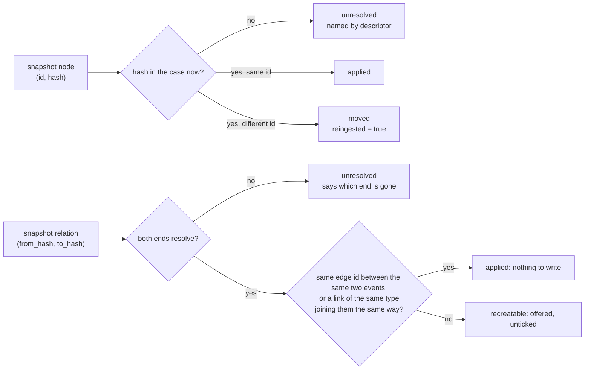

`ApplyRestore` then:

1. **writes the layout first** — each resolved node's position onto its **live** id, and the
   viewport. Nodes and links added since the snapshot are left alone: a restore puts things back, it
   does not roll the graph back;
2. **re-creates only the links the analyst ticked**, and only if the fresh plan still offers them,
   each as `created_by: "user"` with the basis `restored from snapshot <id>` and no rule fields. So
   ticking a link again, or restoring twice, writes nothing. Two ticked rows that make the same claim
   (the same events, direction and type) write one link: the first in snapshot order, with its
   label;
3. **commits those links once**, in one `InsertRelations` batch.

Taking and deleting hold the case lock shared (§18.4), so they are refused while a redaction runs
and in a read-only session (§18.5). Listing and previewing take no lock.

**Applying holds the case lock alone**, as a redaction does, and runs `RepairRelationIndex` before
it plans. It reads the graph's links and writes the missing ones, so anything else writing links in
between could make it draw one twice: a rule run between `DeleteGraphRelations` and
`InsertRelations`, a link drawn by hand, or a maintenance pass rebuilding the index. A restore that
crashed after `InsertRelations` committed its edges, but before it registered them, left a link
`RelationsByGraph` cannot see. The repair makes that link visible again, so it is not offered a
second time. A restore takes seconds, so it is refused while an ingest or a capture runs, and every
other write is refused while it runs. A repair that fails refuses the restore before it writes
anything, including the layout.

**Why it was built that way.**

- **Events are matched by hash, not by id.** Node ids are handed out in order, so a re-ingest gives
  id 1 to a different event. A restore that matched on id would put the saved picture onto unrelated
  records, and the canvas would look entirely normal. Matching on the hash turns that into `moved`
  rows and a note that the case was re-ingested
  (`TestRestoreResolvesThroughHashesAfterAReingest`). An edge id that survived onto different
  endpoints is not trusted either (`TestPlanDoesNotTrustAnEdgeIdWhoseEndpointsChanged`).
- **A link is matched by what it joins, not only by its id.** A link written later always has a new
  id, so a link re-created by a restore, drawn again by hand or inferred again by a rule build has an
  id the snapshot never saw. Matched by id alone, each was offered again, and a second restore drew
  it twice. A snapshot link now counts as still there when the same edge id joins the same two
  events, or when a link of the same type joins them **in the same direction** in that graph (the
  lowest live id is named when several do). Apart from the same edge under its own id, whose type is
  not compared (so a type edited in place still matches,
  `TestPlanKeepsALinkWhoseTypeWasEditedInPlace`), a link's identity is its graph, its two ends in
  order, and its type. Who made it, its label and its basis are not compared, and neither is the
  "restored from" note: the note names one snapshot, so a link restored from one would be offered
  again by another, and hand-drawn and rule-built links carry none. A recorded type this build does
  not know compares as `default`, the type a re-creation writes, on both sides. The plan is a set:
  one apply never writes two identical links, even when the snapshot recorded the link twice
  (`TestPlanTreatsTheSameKindOfLinkBetweenTheSameEventsAsPresent`,
  `TestPlanOffersALinkWhenOnlyAnotherKindOrTheReverseJoinsTheEvents`,
  `TestRestoringTwiceDoesNotDuplicateALink`, `TestPreviewAfterARestoreOffersNothing`,
  `TestPreviewDoesNotOfferALinkARuleBuildMadeAgain`, `TestARestoredLinkOfAnUnknownTypeIsNotOfferedAgain`,
  `TestPreviewFindsAStoredLinkWithNoTypeUnderANewId`, `TestOneRestoreWritesALinkTheSnapshotHeldTwiceOnce`).
- **Nothing restores silently.** The package stores and plans; it never writes to the case store
  (`TestPreviewRestoreWritesNothing`), and every node and relation lands in exactly one bucket
  (`TestEveryItemLandsInExactlyOneBucket`).
- **Inferred ≠ asserted (§0).** A link re-created today is the analyst's claim, not something a rule
  found. Keeping the old `rule_id` would make it look like output of the current rules, and an
  export would say so (`TestARecreatedEdgeIsAssertedByTheAnalystNotByARule`). By default nothing is
  re-created, and the panel ticks nothing for you.
- **Layout first, then the links in one batch.** The layout is always safe to apply, so a failed link
  write does not also cost the arrangement. The links used to be inserted one at a time — a durable
  write each, and a failure part way left some of them; they now commit once (PERFORMANCE.md §18,
  "Signing and attribution"). The restore as a whole is two writes, not one.
- **A snapshot is never destroyed to make room.** At 50 per graph a new one is refused, not the
  oldest evicted, and a file is never overwritten: two snapshots taken in the same millisecond once
  replaced each other silently on a Linux CI runner
  (`TestTwoSnapshotsInTheSameMillisecondBothSurvive`).
- **Redaction (§18.4) scrubs what a snapshot copied.** A snapshot holds copies of event content — the
  descriptor and the rules' `basis` values — so the redaction's sidecar step calls `Store.Scrub`: the
  descriptor becomes `(redacted event)` and touching relations lose their `basis`. A file it cannot
  read fails the step; it is never treated as clean.

**Not done.**

- Snapshot thumbnails.
- `Save` writes a temporary file and renames it without an fsync; only `Scrub` writes durably.
- **A preview after a crash can still offer a link again.** The preview writes nothing, so it does
  not repair; applying it repairs first and writes nothing twice.
- `TakeSnapshot` lists the canvas's ids from a map, so the order of `nodes[]` in the file varies
  between two snapshots of the same canvas.
- `store_version` is recorded and never compared (see the table above).

### 14.6 Annotation layers

**What it does.** An annotation is the analyst's own mark on one graph: a **note** pinned to an
event, a **region**, or an **arrow**. Marks sit on **layers** that can be shown, hidden and reordered.
The package is [backend/annotate](backend/annotate/annotate.go), the binding `AnnotateAPI`
([backend/api/api_annotate.go](backend/api/api_annotate.go)), and the UI
[LayerPanel.svelte](frontend/src/components/graph/LayerPanel.svelte) with
[lib/graph/annotations.js](frontend/src/lib/graph/annotations.js).

An annotation is stored like a finding (§13), but its scope differs:

|              | Finding (§13)                        | Annotation                               |
| ------------ | ------------------------------------ | ---------------------------------------- |
| It is about  | an **event**                         | a **picture**                            |
| It appears   | in every graph that holds the event  | only on the graph it was drawn on        |
| Example      | "this 4624 is the account takeover"  | "this cluster is the lateral movement"   |

**How it works.** One file per graph, `rohy-data/annotations/<graphID>.json`, with
`annotations_version: 1`, holding `layers[]` (`id`, `name`, `colour`, `visible`, `z`) and `items[]`
(`id`, `layer`, `kind`, `anchor`, `to` for arrows, `text`, timestamps). An **anchor** is either
`event`, which stores the event's **hash**, or `world`, a fixed position on the canvas. Every change
rewrites the file (a temporary file, then a rename). Each change is made to a copy of the document,
and the copy held in memory is replaced only once the rename has succeeded, so a failed write leaves
the canvas showing what the file holds. An id is the prefix, the millisecond and a sequence that
starts at the number of entries of that kind (0 for the default layer) and steps past any id in use,
so no two entries held at once share an id.

`Annotations(graphID)` returns the document plus two things the canvas needs, worked out afresh on
every call: `node_of`, mapping each anchored hash to the node that holds it **now**, and `orphaned`,
the anchored hashes no event carries any more. The frontend then places each mark. If any step
fails, the mark has no position: it is **not drawn, and it is counted**. The panel splits the count
into "no longer in the case" and "not on this canvas", because the fixes differ. The two figures are
different units, so the split is approximate. The first is the number of distinct anchored events
gone from the case (`orphaned`, every layer included). The second is the undrawn marks minus that
number, floored at 0, so two notes on one deleted event read as 1 + 1. A mark that *can* be placed
on a hidden layer is skipped and not counted, because hiding it was the analyst's choice. A mark
that cannot be placed is counted whether or not its layer is shown.

| Limit ([backend/consts/consts.go](backend/consts/consts.go)) | Value | When it is exceeded                     |
| ------------------------------------------------------------ | ----- | --------------------------------------- |
| Layers per graph                                             | 16    | refused                                 |
| Annotations per graph                                        | 200   | new ones refused; editing still works   |
| Text (characters)                                            | 2000  | refused, never truncated                |
| Layer name (characters)                                      | 120   | cut between characters                  |

Writes hold the case lock shared, like snapshots; reads take none.

**Why it was built that way.**

- **An event is anchored by its hash, never by its node id**, for the snapshot's reason: a re-ingest
  reuses ids (`TestAnnotationsFollowTheEventAfterAReingest`). The hash-to-id map is never stored,
  because a stored map would bring back exactly the staleness the hash exists to avoid.
- **A mark is drawn only where it can be honestly placed.** A pin at the origin, or snapped to the
  nearest card, would point at the wrong evidence; a mark that quietly vanished would look like one
  never made (`TestAnnotationsReportAnOrphanRatherThanDroppingIt`). The orphan itself is kept: it is
  the analyst's.
- **Deleting a layer deletes everything on it**, and the confirm dialog shows how many marks first.
  Moving them elsewhere would leave marks the analyst thought were gone.
- **Bad input is refused, not guessed at.** An unknown kind or anchor is refused with the accepted
  list; a `to` on anything but an arrow is dropped, so a later build cannot start honouring values
  nobody chose.
- **The screen never runs ahead of the disk.** A cache changed before its write would show a mark
  that a restart loses (`TestAFailedWriteLeavesTheCacheAsTheFileIs`,
  `TestARefusedPutLeavesNoLayerBehind`).
- **No two entries share an id.** `Delete` and `DeleteLayer` remove every entry with the id they are
  given, so two entries sharing one would be deleted together. The count alone can name a held id
  after a delete in the same millisecond (`TestAnIDIsNeverRepeatedAfterADelete`,
  `TestALayerIDIsNeverRepeatedAfterADelete`). An id no longer held can be issued again.
- **Limits count characters**, the unit the messages name. A byte count gave a note in Japanese a
  third of the room one in English gets, and a byte cut could split a character
  (`TestTextLimitCountsCharactersNotBytes`, `TestOverlongLayerNameIsCutBetweenCharacters`).
- **Redaction leaves annotations alone.** An annotation holds only a hash and the analyst's own words;
  rohy copied nothing into it. After the strip the event reports no hash, so its notes count as "no
  longer in the case".

**Not done.** Regions and arrows render, but only notes can be created, from the layer panel. The
panel cannot edit or delete one note, rename a layer or change its colour, though the bindings exist.
The file is written by rename without an fsync. A layer name cut by an earlier build keeps the
U+FFFD that the byte cut left.

**Error codes.** Every refusal in `annotate` (a field it does not accept, or a limit reached) wraps
`annotate.ErrInvalid` and keeps its message as it was. The write bindings code a refusal, or a layer
id that is not there (`ErrNotFound`), `parse_error`: the request's fault, which the analyst can
change. Any other failure is `persistence_error`, the sidecar's (`annotateError`;
`TestEveryRefusalIsMarkedInvalid`, `TestAnnotateBindingsTellARefusedRequestFromAFailedWrite`). They
coded both `internal_error`, which reads as rohy's fault.

---

## 15. Frontend architecture

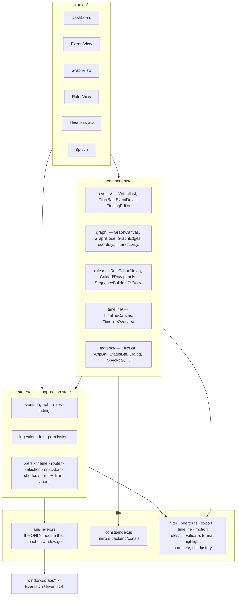

### 15.1 One door to the backend

`lib/api/index.js` is the only module that reads `window.go`. Everything else
calls its exported functions. Two payoffs:

- **Graceful degradation.** Under `vite dev` in a plain browser, `window.go` is
  undefined; calls reject with a clear message and event subscription is a no-op,
  so the UI loads instead of throwing.
- **One place to change** when a binding's shape moves.

### 15.2 Progressive loading

The events list never asks for everything. A fresh load issues **three calls in
parallel**:

```js
const [list, total, undatedHidden] = await Promise.all([
  api.queryEvents(f),                              // the first page
  api.countEvents(f),                              // the accurate total
  api.countEvents({ ...f, undated: UNDATED.ONLY }), // what this view is hiding
]);
```

The third exists so the view can **say** what it is excluding rather than quietly
dropping it. Subsequent pages append, so the loaded count grows toward the true
total and the user never perceives events as missing.

### 15.3 Constants are mirrored, not duplicated by hand

`lib/consts/index.js` mirrors `backend/consts`. Enum values (`UNDATED`,
`FINDING_FILTERS`, `TIMELINE_GROUP`, `RELATION_*`) are the **same strings** on
both sides, with the JS side commented to name its Go counterpart.

The same single-source-of-truth discipline shows up locally too.
[shortcuts.js](frontend/src/lib/shortcuts.js) is the one definition of the
keybindings; both the global handler and the help dialog read it, so a shortcut
can never work while the help claims otherwise. `NAV_ITEMS` is *derived* from
`NAV_KEYS`, so a route reachable by `Alt+<digit>` is necessarily in the menu with
that key shown beside it.

Binding choices avoid OS and browser clashes: navigation uses `Alt+digit`
(WebView2 leaves it alone) rather than `Ctrl+digit` (browser tabs) or bare
letters (which would fire while typing). Bare letters are used only inside the
canvas, and only when focus is not in a field.

### 15.4 Where global concerns are wired

`ingestion.wire()` is called in **`App.svelte`**, not in the Dashboard. The
global progress bar has to reflect a running ingest on **every** route, including
ones reached without ever mounting the Dashboard — and `IngestionBar` sits
outside the routed content so an ingest stays visible across navigation.

---

## 16. The Go ↔ JS contract

### 16.1 Ten bound structs

| Struct           | Responsibility                                                              |
| ---------------- | --------------------------------------------------------------------------- |
| `EventsAPI`      | ingestion control, live capture, permission checks and elevation, event queries, counts, timeline |
| `GraphAPI`       | relations, named graphs, canvas layout, auto-layout, clusters, heatmap, relationship inspection |
| `RulesAPI`       | rule listing, import, export, save, delete, enable/disable, format descriptor |
| `BuildAPI`       | run correlation rules, report progress, dry-run a rule without persisting   |
| `FindingsAPI`    | flags, tags, notes, tag list, stats, audit                                  |
| `SystemAPI`      | build identity, init stages, the analyst's session                          |
| `MaintenanceAPI` | opt-in work over the whole case: the case check and its fixes, backfill (it seals what it rewrote and returns a `BackfillOutcome`: the pass's result plus `sealed` and `seal_error`), compaction, seals and the image check, proofs and custody, redaction, signing, checkpoints, cancel |
| `SnapshotAPI`    | named graph snapshots: take, list, preview and apply a restore, delete      |
| `AnnotateAPI`    | the analyst's layers and annotations on a graph                             |
| `QueryAPI`       | the read-only query console: `Describe` and `Run`, nothing else (#33)       |

`MaintenanceAPI` is separate from `SystemAPI` rather than folded into it because the two
are different concerns: `SystemAPI` reports how the **application** is doing and never
touches case data, while everything on `MaintenanceAPI` reads or rewrites the case itself
and is proportional to how large it is. Nothing on it runs at startup — the same judgement
`VerifyIndexes` already carries (§18).

🔒 `QueryAPI` holds `query.Reader`, the read-only slice of the store, never `*graphene.Store`: a
write is out of its reach at compile time. Reflection tests pin its methods to `Describe` and `Run`
and the reader to known reads. `backend/query` checks every spec against its vocabulary before
reading anything. The vocabulary is the one statement the Query page builds from, and two committed
files hold the page to it (`backend/query/testdata/`). Results are capped at 1000 rows or groups,
with the total always stated.

The console takes no case lock, like every read: a result says when the case moved under it. A
relation query on an indexed field finds what the index lists, so a relation a crash left
half-indexed is missed until the next repair. The integrity check reports that gap.

Note that `App` itself is **not** bound. It manages lifecycle and holds no
business logic, so exposing it would be exposing nothing useful.

### 16.2 Events flow the other way

Method calls go frontend → backend. Anything the backend needs to *push* goes
over named channels, defined once in `consts` and reused on both sides:

| Channel             | Payload           | Meaning                             |
| ------------------- | ----------------- | ----------------------------------- |
| `init:state`        | stage / ready / failed | splash progress                |
| `ingest:started`    | `StartedEvent`    | one file began — with `N of M`      |
| `ingest:progress`   | `evtx.Progress`   | cumulative counters                 |
| `ingest:error`      | `ErrorEvent`      | non-fatal, per record or chunk      |
| `ingest:complete`   | `evtx.Summary`    | terminal, with checkpoint           |
| `ingest:cancelled`  | `evtx.Summary`    | terminal, with checkpoint           |
| `ingest:state`      | ingest state      | running / paused, for the UI        |
| `permission:warn`   | `AccessDecision`  | a channel needs elevation           |
| `rules:started` / `rules:progress` / `rules:complete` / `rules:cancelled` | build lifecycle | rule-run progress |

**Every** error crossing the boundary — emitted or returned — uses one shape:

```go
type ErrorEvent struct {
    Code    string `json:"code"`     // a stable vocabulary: parse, io, persistence, …
    Message string `json:"message"`  // human-readable
}
```

A stable `code` lets the frontend branch on the *kind* of failure — a refused
note is the caller's input being wrong, not the disk failing, and the two deserve
different messages.

**How a returned error crosses (#33).** Until #33 only the message did: Wails sends `err.Error()`
unless an `ErrorFormatter` is set, and none was. `api.FormatError` is now that formatter.
- 🔒 It returns a **string**, the JSON of the `ErrorEvent`. The runtime wraps whatever arrives in
  `new Error(x)` unless it already is an Error, so an object would read "[object Object]".
- `call()` in `frontend/src/lib/api/index.js`, the one door to the backend, decodes the string
  into an `Error` with `.message` and `.code`. Anything it cannot decode is left as it was: Wails'
  own argument-parse text, and "backend unavailable" outside Wails. `errorCode()` calls that
  `internal_error`.
- A wrapped error keeps its code and its full message. An uncoded one is `internal_error`. An empty
  message becomes the code, because an empty error field makes the runtime resolve the call.
- A vitest fails if a backend `ErrCode*` is missing from the frontend's `ERROR_CODES`.

### 16.3 The Emitter seam

```go
type Emitter interface{ Emit(channel string, data interface{}) }
```

Production uses `WailsEmitter`; tests inject a capturing fake. This is why
[emitter_wails.go](backend/api/emitter_wails.go) is the **only** file in the
package that imports the Wails runtime — the bindings and all their tests stay
runtime-independent, which is what allows the API layer to be tested without a
window.

---

## 17. Concurrency model

Small and deliberate. Here is the whole of it:

| Where                    | Concurrency                                                            | How safety is achieved                                              |
| ------------------------ | ---------------------------------------------------------------------- | ------------------------------------------------------------------- |
| Store open               | any number of callers                                                  | `sync.Once` in `ensure()`, giving a happens-before edge              |
| Ingest producer          | 1 goroutine                                                            | owns the offset channel; blocks on backpressure                      |
| Ingest workers           | 4 goroutines                                                           | each opens its **own** file handle — parsing seeks                   |
| Ingest sink              | **1 goroutine**                                                        | all counters and Reporter calls are single-threaded by construction  |
| Order cache              | concurrent readers and writers                                         | `sync.Mutex` + a version counter that rejects stale results          |
| Payload store            | ingest appends while the UI reads                                      | `sync.RWMutex` — appends take the write lock, reads the read lock    |
| Sidecar stores           | UI reads while the pipeline writes                                     | `sync.Mutex` per store, over reads as well as writes (the layout store's since v0.3.0, §14) |
| Pause gate               | UI flips, pipeline observes                                            | mutex plus **replaced** channels, so a waiter cannot latch a stale one |
| Cancellation             | everywhere                                                             | one `context.Context` per run, checked at batch and rule boundaries  |
| Case lock                | every write to the case shares it; a redaction or a restore holds it alone | `api.theCase`: try-only, names its holders in the refusal (§18.4); also the write gate of a read-only session (§18.5) |
| Store open               | a call before the session waits; shutdown releases it                  | mutex + `atomic.Bool` ready, retryable; `Close` holds the open's mutex (§18.5) |
| Key slot                 | a mid-session unlock while commits sign                                | `sync.RWMutex`; `KeyID` never changes, so a commit cannot mix two keys |

The rule of thumb the code follows: **make the hot path single-goroutine and put
the concurrency at the edges.** The sink is the clearest example — it trades a
little throughput for the complete absence of a class of bug.

The pipeline also ships both `race_on_test.go` and `race_off_test.go`, so the
suite behaves sensibly with and without `-race`.

---

## 18. Failure and recovery

This table is the most useful page in the document if you are debugging a
corrupted case.

| Failure                                              | What survives                              | How it recovers                                                                   |
| ---------------------------------------------------- | ------------------------------------------ | --------------------------------------------------------------------------------- |
| Crash mid-ingest                                     | Everything flushed before the crash        | Re-run the ingest; hash idempotency collapses the overlap to occurrence counts     |
| Crash between payload write and event commit         | Orphan bytes in `payloads.log`             | Harmless waste; reclaimed by re-ingesting                                          |
| Crash between event commit and index registration    | The event exists but is not findable        | `RebuildIndexes` restores structure; re-running the write restores property entries |
| Crash between edge commit and index registration     | The edge exists but its graph or its rule does not list it | `RepairRelationIndex`, over every index key — and every rule build calls it first |
| Crash during live capture                            | The bookmark trails the durable write       | Next run re-reads a little; dedup collapses it. **It can never skip.**              |
| Uncompacted close (kill, power loss)                 | The WAL                                    | Replayed automatically on next open                                                 |
| Corrupt capture sidecar                              | —                                          | Treated as "no positions": costs a re-read, not a failed startup                     |
| Findings pointing at absent events                   | Every finding                              | Reported as orphans by `AuditFindings`; **never** auto-deleted                       |
| Findings written by a different hashing recipe       | Every finding                              | `Stale: true` — the UI can say "this is the build, not your data"                    |
| A rule file that will not parse                      | The file, untouched                        | Listed with path + reason; repairable in-app via _Fix_                               |
| Half-cleared graph                                   | —                                          | Cannot happen: clearing a graph is one transaction                                   |

`VerifyIndexes` is deliberately **not** a startup step. Verification is
proportional to the whole store, and a structurally damaged index section is
already rejected while the file is parsed — so running it on every open would tax
every launch to re-prove something almost always true. Its trigger points are the
test suite and an explicit user-initiated check.

### 18.1 Proving one event to someone outside the case

A seal (compaction) gives the case a fingerprint: graphene's snapshot root. An
**event proof** lets someone who kept that fingerprint check one event against it
without the case or rohy. The drawer's _Save proof…_ writes the file and
`rohyctl verify-proof --root <hex> <file>` checks it.

The chain the verifier walks:

```
root you kept ─ graphene proof ─ leaf ─ SHA256(0x07 ‖ stored record) ─ hash_raw ─ raw record
```

graphene's proof stops at a **hash** of the stored record (its v3 leaf), so on its
own it proves only that some node of that id was sealed. The file therefore also
carries the stored record (the exact `json.Marshal(Event)` bytes the node holds)
and the raw record from the payload store. Their hashes close the chain.

| Piece | Where | Note |
|---|---|---|
| `backend/eventproof` | `Assemble`, `Verify` | Storeless. Mirrors graphene's leaf layout in `leaf.go`, pinned by a test against a real sealed store |
| `graphene.Store.ProveEvent` | builds the document | Returns a **state** when the event cannot be proven yet (`not_sealed`, `written_since_seal`, `changed_since_seal`, `image_outdated`, `raw_mismatch`, `unavailable`) |
| `MaintenanceAPI.ExportEventProof` | binding | Adds `fingerprint_exported` for the seal the proof was built against |
| `rohyctl verify-proof` | recipient | Takes the root only from `--root`, never from the file |

An event whose stored record changed after the seal is `changed_since_seal`. A
re-ingest moves its occurrence count, and a backfill rewrites its correlation
fields until the seal it runs at its end (§18.2), so after a backfill the state
is seen only while a pass runs or after its seal failed or was refused. The
remedy is to seal again, and that moves the fingerprint: a copy kept from an
earlier seal will not check a proof built from a later one.

### 18.2 Sealing, and the history of fingerprints

A case is sealed after an ingest request, at the end of a correlation backfill,
from **Seal case** on the Maintenance page, on close, inside a redaction (§18.4),
in a checkpoint publish (§18.6), and when a case starts to sign (§18.5). Every
seal goes through one function, `sealAndRecord` in `backend/api/api_seal.go`
(the backfill and the checkpoint through `sealAndRecordLocked`, under the same
mutex). It compacts
the case, then adds the new fingerprint to the history in
`rohy-data/roots/roots.json` (`backend/custody`).

Every compaction makes a new fingerprint, even when nothing changed, because the
new image names the old one as its predecessor and that link is part of the root.
So the automatic seals (after an ingest or a backfill, a redaction's own seal, a
checkpoint's, and on close) first ask
`graphene.Store.Unsealed()`. That asks whether the log holds any record, any
delta or delete, or whether the case has no image yet. If not, nothing is
compacted, the fingerprint an analyst exported stays current, and `case:sealed`
carries `unchanged`. **Seal case** always compacts, because it is how an image in
an older format gets rewritten.

🔒 The backfill's seal (`MaintenanceAPI.BackfillCorrelationKeys`) follows four
rules:

- **It runs only when the pass rewrote at least one event** (`Projected > 0`), so
  a pass that changed nothing does not seal writes it did not make. `Projected`
  counts a batch only once it has committed. A stopped pass, or one that failed
  part way, is sealed too: what it committed is durable.
- **It runs before the maintenance lock is given back.** The disk engine holds
  every rewritten node in its delta layer, and the WAL every rewrite, until a
  compaction (about 58 MiB at 100 000 events, PERFORMANCE.md §21). Holding the
  lock through the seal also keeps a deep check's image read (`VerifyImage`, §18.7)
  off the image while the compaction replaces it.
- **It never seals a session that can no longer write.** The write gate is asked
  again under `sealMu`, in the seal's own turn, because a seal elsewhere can
  poison the session while the pass runs or while this seal waits. Refused, the
  seal error is `the case was not sealed: …`.
- **It emits no `case:sealed`.** Like a failed ingest seal, a failed backfill seal
  never fails the pass. The outcome rides on the result instead: `BackfillOutcome`
  embeds the pass's `BackfillResult` and adds `sealed` (the `SealOutcome`, nil
  when no seal ran) and `seal_error`. The page drops its image verdict when the
  seal ran (`noteSeal`), and says the fingerprint has changed.

Stop reaches the pass, not the seal: `Compact` takes no context, so a Stop
pressed during the seal does nothing. A Stop pressed then cannot turn a failed
pass into a stopped one either, because the binding reads the pass's own
`Cancelled` flag, not the context. (`TestABackfillSealsWhatItRewroteAndRecordsTheSeal`,
`TestABackfillThatRewroteNothingDoesNotSeal`, `TestAStoppedBackfillStillSealsWhatItCompleted`,
`TestABackfillSealsBeforeItGivesBackTheMaintenanceLock`, `TestABackfillDoesNotSealAPoisonedCase`,
`TestABackfillDoesNotSealACasePoisonedWhileItWaitedToSeal`,
`TestABackfillWhoseSealIsNotRecordedStillSucceeds`, `TestALateStopDoesNotHideAFailedBackfill`.)

| Piece | What it does |
|---|---|
| `graphene.Store.Unsealed` | "Was anything written since the last seal?" Errs towards yes. |
| `graphene.VerifyChain` | Storeless: does this recorded seal directly follow that one? |
| `custody.Store.Chain` | Places the current image against the history: `intact`, `rolled_back`, `unrecorded_seal`, `diverged`, `empty`, `no_image`. Also counts gaps, and forks: a recorded seal whose predecessor is an earlier record, which is a rollback that was sealed again. Read-only. |
| caseintegrity `checkRootChain` | Turns that into findings: `roots_rolled_back` (error), `roots_diverged`, `roots_chain_gap`, `roots_history_unreadable` (warnings), `roots_unrecorded_seal` (info). |

The chain is the case checked against its own record. It catches an image that
is internally perfect but is not the latest one rohy sealed, such as a database
restored from a backup. Every other check passes that image. It does not catch
someone who can rewrite the case folder, because they can rewrite the history
too; only a fingerprint kept elsewhere does that.

Two rules keep a finding from being buried. A seal that ran is always recorded,
so a rollback that was sealed again stays provable as a fork. A seal that did not
run (`unchanged`) records the image only where the history already leads to it,
so closing the case never adopts a foreign image. One mutex, `sealMu`, covers
every seal from check to record, so two seals cannot interleave.

A history document that was read but cannot be used (corrupt, or written by a
newer build) is moved aside as `roots.json.unreadable-<UTC>`, and the new history
notes it under `kept` so every later open reports it. A document that could not
be read at all, or could not be moved, is left in place, and rohy records no seals
that session rather than write over it.

### 18.3 Accounting for one event: the custody report

**Account for this event** in the drawer asks what the case can account for about one event,
layer by layer, and what it cannot. It is a list of gaps, never a verdict: no state of the report
says custody is accounted for.

| Piece | What it does |
|---|---|
| `graphene.Store.EventCustody` | graphene's `CustodyFor(id, nil)` in rohy's shape, plus `ProveEvent`'s state for the record and raw layers. Every field the report decides on is structured; the engine's text is carried only as a cause. |
| `custody.EventReport` | Pure. Decides presence, words each layer, and lists what the report establishes and does not. |
| `custody.Store.DescendsFrom` | Does the current image descend from a kept fingerprint through recorded, verifying links? Read-only. |
| `MaintenanceAPI.EventCustody` | Normalizes the kept fingerprint, then gathers everything under `sealMu`, so no seal lands inside one report. |

Presence is decided absence-first: `not_in_case`, `removed_since_seal` (deleted, still in the last
seal), `redacted`, then `in_seal`, `written_since_seal`, `no_fingerprint`. An id the case does not
hold is never described by the state of the seal.

The event's layers are the seal, its stored record against the sealed one, its raw record, a
removal when one is recorded, the history of seals (#37), and the fingerprint the analyst kept.
graphene's store-wide layers (signature, commit history, audit log, role grants, removal ledger)
read the same for every event, so they are grouped as case records. In this build they are all
"not recorded": rohy opens cases without them (§14.6).

The kept fingerprint is compared against the case's image **now**, whatever the event's state.
graphene's `CustodyForAnchored` compares only when the entity is in the snapshot, which misses the
rollback that removed it, so rohy does not call it. A fingerprint the image descends from is an
earlier seal (not established); anything else is broken, including when the history cannot be
consulted. The drawer never fills the field from the case. It drops the report on another event
and when `caseMark` moves (a seal, an ingest starting or ending, a maintenance pass), never on a
mere store update: both stores replace their state on every progress tick.

A damaged image is reported, not failed: when the engine finds the seal broken, the event's proof
is not asked for, and record and raw read "not checked". A layer's `remedy` (seal, or seal again)
is cleared whenever the history is broken.

### 18.4 Redacting one event

**Redact this event…** removes an event's content from everywhere rohy put it, records the
removal in graphene's ledger with its reason, and keeps the content from coming back. The node
stays, so the analyst's relations and the fact of the removal survive.

| Piece | What it does |
|---|---|
| `payload.Store.Redact` | Overwrites a payload record in place, same length: `0x00 'R' 'D' 'X'`, a version, the owning event's id, zeros. Refuses a reference whose framing it cannot confirm by walking the log from the start, so crafted evidence cannot steer the write. |
| `graphene` primitives | `RedactEventRecord` (strip the record, then purge its index; a retry finishes a purge that did not land), `RedactRelation`, `EventsSharing`, `PayloadCopies`, `TombstonePayload`, `LedgerFramingClean`. A relation or event removed outside a redaction is a `GoneError`. |
| `redaction.Journal` | `rohy-data/redactions/journal.json`, written durably (`backend/durable`) before anything is destroyed: the only place the payload references survive the strip. It is also the suppression list. |
| `redaction.Prepare` / `Run` | Resolve the targets (the event and every event holding the same record), then run five steps — relations, records, payloads, sidecars, seal — each recorded as it ends. Pure over narrow interfaces, so each step is fault-injected in tests. |
| `MaintenanceAPI` | `PreviewRedaction`, `RedactEvent`, `PendingRedactions`, `FinishRedaction`. Checks everything that must hold first, under the case lock held alone. |

The invariants, each a test:

- **Nothing brings it back.** Ingest skips a record whose `hash_normalized` or `hash_raw` the
  journal names, whether or not it deduplicates; a journal that cannot be read refuses the ingest.
  Dedup counts and the backfill skip a stripped event; a build reads through the timestamp index,
  which a stripped event has left; `toNode` refuses an event read as redacted; a finding written on
  a redacted hash keeps no descriptor.
- **Nothing races it.** Every binding that writes the case, or a copy of an event's content,
  shares `api.theCase`; a redaction takes it alone, as a snapshot restore does (§14.5). Both sides
  only try, so nothing waits behind a redaction and a redaction never starts unattended behind a
  long ingest.
- **Every step can be run again.** Finishing a redaction is running it again: what landed does
  nothing, what did not lands. A failure stops at its step; later steps report "not reached".
- **The definition of done is checked on disk.** The end-to-end test searches every file under the
  case folder for the raw record and the copied values — present before, absent after — and finds
  the analyst's own note exactly once.

Refused on an in-memory case (no ledger) and on a ledger whose framing does not match its size
(the next record would be misframed, and every seal after it would fail). An image older than body
version 3 is sealed first, so the ledger's hashes match the image the redaction's own seal writes.

### 18.5 Who did it: the session, attribution and signed seals

graphene takes the signer, the verifier and the actor at **open**, so how a case opens is decided
before it opens, at the session step. What the step reads, it reads from files: the store waits.

| Piece | What it does |
|---|---|
| `keyfile` | An Ed25519 key sealed under the analyst's passphrase (argon2id, AES-256-GCM, every public field in a fixed binary AAD). Refuses a path inside the case's working folder, comparing files rather than strings, at creation and at every unlock. Never replaces a file. |
| `analyst.Profiles` | Per user, outside every case (`os.UserConfigDir()/rohy/analyst.json`): the name, a random analyst id, the key's path, and each case this analyst signs with how its log was left at the last clean close. |
| `analyst.Register` | Per case (`rohy-data/analysts/register.json`): analysts (actor id derived from the analyst id), keys (each signed over its analyst), the signing state and its intervals, each recording where the seal chain, the ledger and the audit log stood. Fails closed: unreadable is *unknown*, never *unsigned*. |
| `graphene` | `OpenAwaitingSession` / `BeginSession` (retryable; a failed open keeps nothing), the `Posture` (mode, actor, `KeySlot`, verifier), attributed transactions for every write rohy can commit, the audit log on for every disk case with its framing checked first. |
| `custody` | The seal history (format 2) records who sealed and the signature; the report's **signing** layer requires what the engine does not. |
| `api.Session` | The step's decision, the open, the close; `api.theCase` gains the write gate. |

The modes, fixed at open:

| Mode | Signer | Verifier | Unsigned commits refused | Writes |
|---|---|---|---|---|
| `unsigned` | — | — | no | yes |
| `signed` | key slot, unlocked | the register's bound keys | yes, except on the open that turns signing on | yes |
| `signed`, key locked | key slot, locked | the register's bound keys | yes | no — the engine refuses a signed batch or seal itself, and the write gate everything else |
| `unsigned_after_signed` | — | — | no | yes |
| `recovery` | — | — | no | no |

The invariants, each a test:

- **The register alone never says a case is unsigned.** A case is treated as signed if the register,
  the image's own signature, or the analyst's profile says so; a disagreement is a choice with a
  reason, never a silent start.
- **A signed log is not proof nothing was added.** graphene applies records written outside a batch
  unchecked. So a signed case whose log is not as this analyst left it is flagged before it opens,
  and nothing is signed over it until the analyst accepts it with a reason; unlocking mid-session is
  refused in a flagged session.
- **Nothing is lost to a failed open.** A strict open that fails leaves the store closed and offers
  recovery; closing the window at the session step opens nothing and seals nothing.
- **A read-only session writes nothing** — not the case, not its sidecars, not the audit log, not a
  damaged seal history moved aside (`custody.OpenDeferred`); the image check still runs.
- **The audit log holds no evidence.** rohy's entries are ids, counts and the analyst's reasons; a
  test searches the file for an ingested needle.
- **No secret reaches the log.** Passphrases cross one struct argument; the key bindings recover
  their own panics; `api.SafeLogger` withholds the call Wails would log on a failed one.

**What the integrity report says about it (#43).** `caseintegrity` reads three more values, gathered
by `MaintenanceAPI.readPosture` under `sealMu`:

| Dep | From | Detector |
|---|---|---|
| `Signing *SigningPosture` | the session's notes (gaps, the log it did or did not accept), the register, `custody.SealCounts`, `custody.SealVerdict` | 14, and the session's own posture |
| `Ledger *graphene.LedgerState` | `Store.LedgerState(keyring)`: the keyless chain check, then each signature under the bound keys | 16 |
| `Checkpoints *caseintegrity.Anchoring` | `Store.Histories` (each history read once), the receipts, the analyst's profile (#42) | 17 |

- **Lock order is the session's lock, then `sealMu`.** `Begin` and `Close` take them in that order,
  so `readPosture` reads the session's notes before it takes `sealMu`.
- **An unsigned ledger record is judged by its interval** (`Document.SignedAtLedgerSeq`): the
  ledger's chain does not cover signatures.
- **A nil dep is a note, never a clean line.** With the register unreadable, the keyring is nil
  and the ledger's signatures are `unchecked`, not failing.
- **A read-only session's report carries no write action** (`withholdWrites`).

### 18.6 Checkpoints: the digest out, the receipt in (#42)

rohy ships no anchor. `MaintenanceAPI.PublishCheckpoint` records a checkpoint through graphene's
`PublishCheckpoint` with a **hand-off** anchor that publishes nothing, and returns a statement whose
digest the analyst publishes. What came back is recorded with `RecordCheckpointReceipt` in
`rohy-data/roots/receipts.json` (`backend/anchor`).

| Path | Locks | Writes |
|---|---|---|
| `PublishCheckpoint` | maintenance lock, case lock shared, then `sealMu` across the keep-aside, the seal (when unsealed), the checkpoint and the profile record | yes |
| `RecordCheckpointReceipt` | case lock shared | yes |
| `CheckCheckpoint`, the drawer's `EventCustody` | case lock for reading, `sealMu` | no |
| `CheckpointStatement`, `Checkpoints` | none | no |

Ordering of a publish:
1. Ready the chain: keep a torn tail aside, refuse a broken chain.
2. Seal if unsealed (`sealAndRecordLocked`). Abort if the seal failed or left the session unable to
   write.
3. Call `PublishCheckpoint`. The engine writes its audit announcement, captures, and appends.
   - On error, no digest is handed out, and rohy writes "checkpoint N was not recorded".
4. 🔒 Nothing after this returns an error. The statement and the profile record failing are gaps.

Invariants, each a test:
- A record's stored digest is trusted only after `VerifyCheckpointChain(chain[:K])`.
- Every history is checked on its own at K: at least K's count, the prefix verifies, the last hash
  is K's head. A history that cannot be read is unread, not changed.
- A deleted chain is caught two ways:
  - the engine's announcements in the audit log, a kind no caller can write
  - the analyst's profile, matched by case id or by the seal the checkpoint named
- The best detector-17 state is info and says rohy cannot check the anchor. A receipt is the case's
  own record.
- The held digest is never prefilled from the case. A seal fingerprint pasted there is pointed to
  the custody check.

### 18.7 The case check — and what it could not see

**What it does.** The Maintenance page (`Alt+7`) has **Check case** and **Deep check**. Each reads the
whole case and returns a report: what it looked at, what it found grouped by severity, and for each
finding the fix it needs. The check is [backend/caseintegrity](backend/caseintegrity/caseintegrity.go),
and it has one rule: **it reads and reports. It repairs nothing on its own and deletes nothing,
ever.** A fix is a separate button the analyst presses.

It is built around one distinction: a case that is **broken** and a case that is only **empty**.
"This rule found nothing" and "this rule could not have found anything" both show up as a zero; a
report that treats them alike has the analyst trusting an answer that was never computed.

```mermaid
flowchart LR
    page["MaintenanceView<br/>Check case · Deep check"] --> bind["MaintenanceAPI.CheckIntegrity(deep)"]
    bind --> deps["narrow read-only interfaces<br/>over the concrete stores"]
    deps --> run["caseintegrity.Run"]
    run --> rep["Report: findings · counts · errors · deep"]
    rep --> page
    page -- "fix button" --> fix["RepairRelationIndex · RebuildIndexes ·<br/>BackfillCorrelationKeys · CompactCase · …"]
    fix -- "re-check at the same depth" --> bind
```

#### One run

`Run` first reads `graphene.Inventory`: one pass over every event, decoding a small view of each,
collecting counts per channel, coverage per correlation slot, the stale-projection count and the
furthest payload byte any event references. It then runs its detectors in a fixed order, checking
for cancellation between them, and sorts the findings by severity, code and subject, so the same
case always gives the same report. The report carries `findings` (never `null`), `counts` (what was
looked at), `deep`, and `errors` — the checks that **could not run**.

#### The detectors

| #   | Detector             | Code → severity                                                 | Fix                                  | Cost                         |
| --- | -------------------- | --------------------------------------------------------------- | ------------------------------------ | ---------------------------- |
| 1   | Index verification   | `index_damaged` → error                                         | **Rebuild the indexes**              | **deep only**, whole store   |
| 2   | Unindexed relations  | `unindexed_relations` → error                                   | **Repair the relation index**        | every relation               |
| 3   | Findings audit       | `orphan_findings`, `stale_findings` → warning; `redacted_findings` → info | ingest · review              | one hash set                 |
| 4   | Dangling relations   | `dangling_relations` → error                                    | review                               | every relation               |
| 5–6 | Orphan / empty graphs | `orphan_graph` → warning; `empty_graph` → info                 | review                               | one count per graph          |
| 7   | Saved canvases       | `damaged_layout` → warning; `orphan_layout`, `kept_layout` → info | review                             | every canvas file, read      |
| 8   | Payload tail         | `payload_tail` → info                                           | —                                    | two numbers                  |
| 9   | Stale projection     | `stale_projection` → warning                                    | **Fill in correlation fields**       | the inventory pass           |
| 10  | Missing channel      | `missing_channel` → warning; `channel_undeclared` → info        | ingest                               | the inventory pass           |
| 11  | Rule inertness       | `rule_inert`, `rule_blocked` → warning                          | ingest · **Fill in correlation fields** | one count per distinct event id |
| —   | Redactions           | `redaction_journal` → error; `redaction_pending` → warning      | review · **Finish the redactions**   | in memory                    |

A fix in **bold** is a button; the rest are advice, because "ingest the missing log" needs files
rohy does not have.

v0.3.0 added the **forensic detectors**, numbered 12 to 18, plus checks of the seal history and of
the session. They ask a different question — what the case can **prove**, not whether it is broken —
so most report a *posture*, not a fault: an unverified image, a case never sealed, unsigned seals, no
fingerprint kept outside the case, the redaction ledger, checkpoints. Each is explained where its
evidence is: §18.2 (sealing and the history), §18.5 (signing, the session, the ledger) and §18.6
(checkpoints). Their order matters: a case whose fingerprint cannot be read, or that was never
sealed, stops there, so the image, signing and checkpoint checks run only on a sealed case.

#### Three zeros: inert, blocked, unmatched

Every enabled rule gets one of three verdicts:

1. **Inert** (`rule_inert`). Some event id the rule needs has no events. A lineage rule has no
   `sequence`, so its ids are its creation ids (by default `4688`); reading `sequence` alone would
   call every lineage rule satisfiable. Each distinct id is counted once and cached across rules.
2. **Blocked** (`rule_blocked`). Every id has events, but a `match_fields` slot has zero coverage: no
   event carries that value, so the rule can only report zero. The fix offered is the backfill,
   because on an older case that is the usual cause.
3. **Unmatched** — neither. It is the only clean result, and it produces **no finding**.

A count that fails is stored as `-1` and treated as *present*: the rule is not called inert, and the
failure goes into `errors`. A wrong finding from an internal error is worse than a missing one,
because it sends the analyst looking for evidence that is there.

A rule that declares no `channels` is never reported missing; it is counted, once as
`channel_undeclared` and once as `counts.rules_unchecked`, which the page shows even at zero. Every
built-in declares its channels, and a test enforces it, so on a fresh case the check covers the
whole shipped library.

#### Saying what it could not see

- **`errors`, never silence.** A read that fails becomes a line in `errors`, and the page then says
  the report is **incomplete** — "read this as unknown, not as clean".
- **A quick check says it was quick.** A clean quick report adds that the index itself was not
  verified, and on a sealed case adds `image_unverified`.
- **An unread forensic input is a note**, never a pass.
- **No guessed numbers.** If the inventory cannot be read, the payload tail detector stays quiet
  rather than reporting the whole log as a tail.

#### How it stays read-only

The detectors receive **narrow interfaces** that list only the reads they need — `EventStore`,
`FindingStore`, `GraphRegistry`, `RuleSource`, `ForensicStore`, `RootHistory` — never the concrete
stores, so a write is out of reach without a type assertion. `CountUnindexedRelations` exists for
this reason: `RepairRelationIndex` repairs while it counts, so asking it "is a repair needed?" would
change what is being reported. `TestCheckIntegrityWritesNothing` runs a deep check and asserts the
node count and the store version did not move. A read-only session (§18.5) removes every write
action from the report, and the page disables those buttons.

The check takes **no** maintenance lock, so an analyst can find out why the case looks wrong while it
is being repaired. The exception is the deep image verification. It goes through the *Check the case
has not changed* binding (`VerifyImage`) and takes the lock as the button does, for two reasons: its
~449 MB of allocation beside a backfill would slow both, and a backfill's seal replaces the image
file under that lock: on Windows, a read that holds the file open makes that replacement fail. Like every claim
of that lock it only tries, so while a pass runs the report notes that the image was not verified,
and the rest of the check still runs (`TestADeepCheckLeavesTheImageToARunningPass`,
`TestADeepCheckReleasesTheMaintenanceLock`). Each fix binding takes the lock, so a second pass is
refused rather than queued, and after a fix the page runs the check again at the same depth.

#### Why it is built this way

- **A tidy checker destroys evidence.** One that repaired as it went would erase the proof that
  something went wrong — the only thing a report is for. It is the rule that keeps orphaned findings
  on disk (§13).
- **Deep is opt-in.** The index and image checks cost time in proportion to the whole store, and
  running them on every check re-proves something almost always true (PERFORMANCE.md §12a, §18).
- **Narrow interfaces make each detector testable** against a handful of literals, with no live case.

**Not done, or not yet true.**

- **A check cannot be stopped.** `CheckIntegrity` passes `context.Background()` to `Run`, and
  `CancelMaintenance` reaches only a backfill, so the Maintenance page offers Stop only while a
  backfill runs (it gates on the store's `backfill` run kind). Stop stays shown, and does nothing,
  while the seal at the end of a backfill runs (§18.2).
- **A backfill started from the Rules page is not shown on the Maintenance page.** The page does not
  ask on mount whether a pass is running, so it shows no progress and no Stop for it.
- While a deep check verifies the image (~0.6 s at 100k), a backfill, **Seal case**, a rebuild, a
  repair, a checkpoint publish or the image button is refused as "a maintenance task is already
  running", and a redaction is refused because the case is busy. The maintenance store shows itself
  busy for that whole step, including the quiet deep re-check after a pass (`recheckRunning` in
  `stores/maintenance.js`), so the buttons that go through it are not offered then. Only a pass that
  does not go through the store can meet the refusal: a backfill started from the Rules page. A read
  that fails inside a pass leaves the store busy (`note`, not `fail`), so it cannot free the page
  early.
- The inventory is read twice per check: once for the payload size, once in `Run`.
- `rule_unmatched` is declared and never emitted: "unmatched" is the absence of a finding.

---

## 19. Performance decisions ledger

The full reasoning is in [PERFORMANCE.md](PERFORMANCE.md). The short version —
**every entry exists because a measurement produced a surprise**:

| Decision                                            | Measured effect                                             |
| --------------------------------------------------- | ----------------------------------------------------------- |
| Move raw record + parsed fields to a cold store      | 3137 → 867 B/event resident. **70% of memory removed.**      |
| Do **not** declare the timestamp key ordered         | Open at 100k events: 8.0 s → **0.8 s**                       |
| Decode a minimal sort view instead of the full Event | Ordering no longer materialises kilobyte payloads            |
| Cache the id ordering against filter + version       | Paging hydrates one page, not the whole matching set         |
| Batch relation writes (512 per commit)               | Rule builds go from write-bound-per-edge to one commit/chunk |
| Batch dedup increments                               | Removes a durable write per duplicate                        |
| `Degree(id, nil)` over the typed form                | The typed form is ~**488×** dearer — it inspects every label |
| `EdgesOf(..., nil)` — no edge-type filter            | `EdgeRelation` is the only label rohy writes, so filtering costs and selects nothing extra |
| Store the correlation projection **by position**     | +138 B/event saved against the same values keyed by name      |
| Bound each correlation slot to its own domain        | Format worst case 819 → **324 B/event** (381 B at v3's thirteen slots); 71 B on a real 4688 |
| Prepare the correlation dataset **once per build**   | 20 rules: 505 → **282 ms**, and 56.1 → **16.2 MB** allocated  |
| Index `rule_id` on edges, but not `match_id`         | Low-cardinality answers "which edges did this rule produce"; a near-unique key is the shape that cost 8.0 s at open |

Added in v0.3.0:

| Decision                                            | Measured effect (100k events unless stated)                 |
| --------------------------------------------------- | ----------------------------------------------------------- |
| Verify the image on a button; `VerifyOnOpen` off 🔒   | On, it would add **+617 ms and +449 MB** of allocation to every launch |
| Seal once per ingest **request**, deferred 🔒         | A seal costs the case, not the ingest: **1325 ms, 566 MB** to add 500 events |
| Ask `Unsealed()` before sealing                      | **1.1 ms, 1.6 KB** instead of a ~1.3 s compaction on close   |
| `src_ip` is an alias of `ip_address`, not a slot     | v3's three network slots cost **+57 B** (324 → 381), budgeted at 300–450 |
| Prove one event on a click, unoptimised             | `ProveEvent` **94 ms, 50 MB**, linear                        |
| Custody report: two proofs, not one shared          | `EventCustody` **184 ms**; sharing would halve it and open a second path |
| Do **not** index `hash_raw` for redaction            | Preview **597 ms, 127 MB** once per redaction, against an entry per event on every open |
| Every write is an attributed transaction             | One 512-event batch: 2.6–3.2 → **2.4–4.7 ms**, within the spread |
| Checkpoint reads walk histories, not events          | `Histories` + `Holds` + `Current`: **2.2 ms**, flat in events |
| Ingest chunks in file order, a window of 12          | Live heap 18–23 → **17–25 MiB**; ceiling 96 MiB unchanged    |
| The relation repair checks every key, not one        | **+20–40%** time, transient memory; a build step, not a hot path |
| A build's memory grows with the case, not its rules  | 20 rules ≈ **1.25×** the heaviest one; `TestTheBuildStaysBounded` fails above 2× |
| A canvas reads node records only (`GetEventRecords`) | Layout binding at 5k nodes: 133–165 → **~25–40 ms**, 46–50 → **8.3–12.0 MB** |
| The backfill seals what it rewrote 🔒                 | Its live heap (58.4 MiB after a 100k pass) is held only for the pass; a compaction gives back ~85% |

Measured in v0.3.0 and not yet acted on (PERFORMANCE.md §21): a heatmap of one small graph pays
the whole-case event scan (§14.3). The backfill's live heap still grows with the case while the
pass runs (5.9 MiB after a 10k pass, 58.4 MiB after a 100k one), although it works in fixed
batches: the engine's delta layer holds every rewritten node until the seal at the end of the pass
(§18.2).

That `EdgesOf` entry carries a standing caveat in the source: **if a second edge type is
ever introduced, that call must filter again.** It is one reason process lineage models
ancestry as event → event edges rather than introducing a `Process` node type (§11.6).

The cost model in one table — know what dominates before optimising anything:

| Layer                     | What dominates                          | What does **not**                          |
| ------------------------- | --------------------------------------- | ------------------------------------------ |
| Event queries             | Decoding matched records                | Locating candidate ids                     |
| Ingest / graph build      | The number of **durable commits**; in a build, ~40% is decoding node records | Property encoding |
| Store open                | Loading the property index              | Loading the graph itself (~131 ms at 100k) |
| Ordering / paging         | Decoding a minimal per-node view        | Re-querying — the order is cached          |

> **In rohy, making a lookup asymptotically faster usually buys nothing, because
> the lookup is not the cost.** Reducing how many records get decoded, or how many
> commits get made, usually buys a lot.

---

## 20. Testing strategy

**1,207 Go test functions**, 10 fuzz targets, 65 benchmarks, **855 frontend test
cases** in 56 files, and **58 extension tests**.

Where each runs:

- **Every release build job** (Windows, both Linux runners, macOS) runs
  `go test ./backend/...` and the frontend's `npm test` before it builds, so a
  release is never packaged from a failing tree.
- **`ci.yml`**, on every push to `main` and every pull request, runs on Linux only:
  `go vet`, the backend, `cmd` and `tools` tests, the race detector over
  `graphene`, `evtx`, `api` and `graphbuild`, the frontend tests, the built-in
  rules' format and load check, and the schema golden. Its build job compiles each
  platform without testing again.
- **The local gate only:** the integration suite (`-tags=integration`) and the
  extension tests. A CI job for each is deferred with the other CI additions.

| Kind                | Where                                                       | What it proves                                          |
| ------------------- | ----------------------------------------------------------- | -------------------------------------------------------- |
| Unit                | throughout                                                  | pure logic — normalizers, validators, coords, filters     |
| Consistency         | `graphene_consistency_test.go`                              | a write path left the index truthful                      |
| Scale               | `evtx/scale_test.go`                                        | memory stays bounded as input grows                       |
| Race                | `race_on_test.go` / `race_off_test.go`                      | the pipeline is clean under `-race`                       |
| Benchmarks          | `graphene_bench_test.go`, `*_lifecycle_bench_test.go`        | the numbers in PERFORMANCE.md are reproducible            |
| Lifecycle           | `api_lifecycle_test.go`                                     | startup/shutdown ordering, including drain-before-close   |
| Reflection          | `rules/schema_test.go`                                      | every `Spec` field is documented in the editor descriptor |
| Crash / idempotency | `graphene_*` + `evtx_*`                                     | an interrupted build re-runs without duplicating          |
| Contract            | `cmd/rohyctl/validatejson_test.go` + `tools/vscode-rohy/test/fixtures` | `rohyctl validate --json` prints what the extension reads |
| Extension           | `tools/vscode-rohy/test/` (`npm test`, Node's own runner)    | which files are checked, when, and which answer is kept — through a fake VS Code API |
| Fuzz                | 10 targets: `evtx` parse, `query` run, proof verify, the analyst profile and register, anchor receipts, the keyfile and redaction-journal decoders, fingerprint normalization, and payload redaction | untrusted bytes never panic, and what is accepted round-trips |
| Integration         | `backend/integration/` (`-tags=integration`)                 | the real pipeline on disk over a committed EVTX fixture, against a golden summary; crash recovery; a build's memory bound |
| Parity              | frontend tests that read backend files: `lib/api/errors.test.js`, `lib/rules/*.test.js`, `lib/query/spec.test.js`, `lib/consts/limits.test.js`, `lib/findings.test.js` | every backend error code has its JS twin; the editor and query page agree with the Go cases and vocabulary; the mirrored bounds match `consts.go`, and the findings editor counts a note as Go does |
| Golden              | `rules/testdata`, `backend/query/testdata/`, `backend/findings/testdata/` | the rule schema, the query vocabulary and the note-limit cases change only on purpose |

Two testing choices worth copying:

- **In-memory backends have identical semantics** to the disk ones, so nothing
  behaves differently under test than in production. (With one honest caveat,
  recorded in PERFORMANCE.md: **benchmark the disk backend**, because in-memory
  runs understate write-path changes badly — commit count only costs on disk.)
- **The interfaces exist for the fakes.** `EventSink`, `Reporter`, `Emitter`,
  `LayoutStore`, `PositionStore` all exist so a test can substitute something
  trivial and assert on the calls.

---

## 21. Build and release

```mermaid
flowchart TD
    tag["git push tag v*"] --> ver["<b>version job</b><br/>resolve the SemVer ONCE,<br/>so every artefact reports the same identity"]

    ver --> win["<b>windows-latest</b><br/>amd64 + arm64 from one runner<br/><i>no cgo — the WebView2 loader is pure Go</i>"]
    ver --> lin1["<b>ubuntu-22.04</b><br/>linux/amd64"]
    ver --> lin2["<b>ubuntu-22.04-arm</b><br/>linux/arm64"]
    ver --> mac["<b>macos-latest</b><br/>amd64 + arm64 from one runner<br/><i>cgo, but Xcode targets both</i>"]

    win --> gate; lin1 --> gate; lin2 --> gate; mac --> gate

    gate["<b>release job</b><br/>verify all six artefacts arrived<br/>— refuse to publish an incomplete release —<br/>then generate SHA256SUMS.txt"]
    gate --> pub["GitHub release"]
```

Every build job runs `go test ./backend/...` **and** `npm test` before it builds.

The VS Code extension is not part of this matrix. It is a separate package with no
dependencies, built by hand with `npx @vscode/vsce package` in `tools/vscode-rohy`;
its tests run in the local gate, and a CI job for it is deferred with the other CI
additions.

Two guarantees are inherited from the local build scripts and must not be
weakened in CI:

1. **`frontend/dist` is deleted before every build and is never cached.** The Go
   binary embeds whatever is in `dist`, so a stale `dist` ships an old UI behind
   a new backend.
2. **Version metadata is injected at link time and reflects reality** — including
   marking a dirty tree with a `-dirty` suffix — so an artefact can always say
   exactly what it was built from.

Linux builds against WebKitGTK **4.0** rather than 4.1 deliberately, to keep the
artefact usable on older distributions; the README states 4.0 as the runtime
requirement to match.

```go
// backend/version — one source of truth, injected via -ldflags
var (
    Version = "0.0.1"   // overridden at link time
    Commit  = "dev"
    Date    = "unknown"
)
```

Everything that shows a version — the About dialog, the window, the README's
claim — reads from here, so the surfaces cannot drift apart. An unstamped local
build reports `Development: true` and the UI **says** it is a dev build rather
than presenting it as a release.

---

## 22. How to extend rohy

Practical recipes. Each lists every file you must touch — the point being that
the design keeps these lists short.

### Add a new filter field to the events list

1. `backend/consts` — add the property key if it should be indexed.
2. `graphene/schema.go` — add it to `indexValues()` **and** decide whether it
   belongs in `searchBlob`.
3. `graphene/graphene_query.go` — add it to `EventFilter` and either
   `propertyFilters()` (indexed) or `matchesPostHydration()` (not indexed).
4. `graphene/graphene_order.go` — if it is not indexed, add it to
   `eventSortView` and `matchesSortView`, **and add it to `orderKey()`**.
5. `api/contracts.go` — add it to `EventQuery`; map it in the binding.
6. `frontend/src/lib/filter.js` + `FilterBar.svelte` — form field and mapping.

> **The step people forget is 4's `orderKey()`.** Miss it and paging a filtered
> list will be served the *previous* filter's cached ordering. There is a comment
> in the source saying exactly this, because it has to be said.

### Add a field to the rule format

1. `rules/rules.go` — add it to `Spec`.
2. `rules/validate.go` — validate it, with a stable code and a located error.
3. `rules/schema.go` — describe it: prose, kind, allowed values, bounds, group.
4. `RULES.md` — document it.

Both editors and the client-side pre-validation regenerate themselves from step
3. A reflection test **fails the build** if you skip it.

### Add a correlation algorithm

1. Implement `autograph.Algorithm` — pure, deterministic, writes nothing, and does not
   mutate the `Dataset` it is handed (it is shared by every rule in the build).
2. Register it in `autograph.registry`, and add a descriptor to `consts.Algorithms` naming
   the fields it reads. 🔒 A test asserts the two agree in **both** directions.
3. Describe any new field in `rules/schema.go` with `AppliesTo` naming your algorithm, and
   validate it in `rules/validate.go` — dispatching on the algorithm, not unconditionally.
4. Add fixture cases to `backend/rules/testdata/validation-cases.json` **first**: it drives
   both the Go and the JS validator, so a rule enforced on one side only is a red test.
5. Document it in RULES.md §7 and §8 — especially §8, which states what a match *establishes*.

No caller changes: `graphbuild` dispatches through `autograph.GenerateWith`. Adding an
algorithm does **not** bump the rule format version — a build that lacks the implementation
refuses the name, which is the guard a version would otherwise be (RULES.md §5).

### Add a correlation field

1. **Append** to `consts.CorrelationSlots` — never reorder or reuse a slot (§5.6).
2. Add its source field names, class and length bound alongside. A field whose provider names
   endpoints by the local side (as WFP does) needs orienting in `graphene/correlate.go` before
   projection, or its meaning flips with the connection's direction.
3. Bump `consts.CorrelationKeyVersion`, so existing events become detectably stale and the
   backfill re-reads them.
4. Check `TestCorrelationProjectionBudget` still passes. If it does not, shrink the
   vocabulary — do not raise the ceiling.
5. Regenerate the goldens: `go test ./backend/rules/ -run TestSchemaGolden -update-schema-golden`
   and `go run ./tools/genschema`. A second NAME for an existing slot goes in
   `consts.CorrelationSlotAliases` instead — it is served as `aliases` and lands in the generated
   enum, so the editor, `rohyctl` and VS Code all accept it.

### Add an ingestion source

1. Write a reader that produces `chunkResult` values.
2. Write a normalizer that produces `*graphene.Event` — **hashing over the same
   ordered fields** as the existing ones, or cross-source dedup breaks.
3. Dispatch to it in `evtx.Ingest`.
4. Add a `consts.SourceType*`, **and its entry in `consts.identityRecipes`**. Windows event data
   takes `IdentityRecipeWindows`; a source whose scalars do not identify a record (two IDS
   alerts in one microsecond) takes `IdentityRecipeRecordBytes`, or its records collapse into
   one. `TestEverySourceTypeHasADeliberateIdentityRecipe` fails until the choice is made.
5. If the reader hands records over on its own goroutine, wrap each record's normalization in
   `guardRecord`: `runIngestion`'s recover cannot catch a panic on another goroutine.

Reuse `runSink` unchanged. Dedup, batching, bookmarks, progress and crash-safety
come for free — that is the entire reason the sink is a separate function.

### Add a page

1. `frontend/src/routes/YourView.svelte`.
2. `lib/consts` — add the id to `ROUTES` and its label to `UI` (`NAV_…`).
3. `routes/views.js` — map the id to the component in `ROUTE_VIEWS`. `views.test.js` fails for a
   route with no view. `App.svelte` needs nothing: it renders `viewFor($route)`.
4. `lib/shortcuts.js` — add it to `NAV_KEYS` and `NAV_LABELS`; **the menu derives itself.** Add
   the binding to `SHORTCUTS` too, or the self-documentation test fails. Alt+9 is the last digit
   left; a tenth page needs a different way in.
5. Add it to `frontend/src/components/smoke.test.js`. Svelte compiles for the server, so a
   component can be rendered in plain Node — no jsdom, no testing-library. It catches a
   `ReferenceError` that `vite build` cannot, because an undefined identifier in a `<script>`
   block is legal JavaScript.

### Add a backend error code

1. `backend/consts` — add `ErrCodeYours = "yours_error"` beside the others.
2. Return it from the binding as `AsError(consts.ErrCodeYours, err)`. `FormatError` carries the
   code across (§16.2); wrapping with `%w` keeps it, because the formatter finds the code with
   `errors.As` and takes the message from the outermost error.
3. `frontend/src/lib/consts` — add it to `ERROR_CODES`. `lib/api/errors.test.js` reads
   `consts.go` and fails until every `ErrCode*` has its twin.
4. In the screen, branch on `errorCode(e)` from `lib/api/errors.js`, never on the message text.

### Add a query console field

1. If the store cannot answer it yet, teach `graphene` first: a field on `EventFilter` (the first
   recipe above) or `RelationFilter`. To group by it, add a short scalar to `eventSortView`, its
   name to `EventGroupFields`, and a case to `sortViewField`, the switch `CountEventsBy` uses
   (`graphene_console.go`). Miss the case and the switch's default reads `SourceIdentifier`
   instead, silently.
2. `backend/query/vocabulary.go` — add a `Field` to `eventFields` or `relationFields`: key, label,
   kind, ops, `Groupable`, enum `Values`, and `Help` worded for the analyst.
3. `backend/query/run.go` — map the condition onto the filter and, if it groups, read its value.
4. Regenerate the golden (`go test ./backend/query/ -run TestVocabularyGolden
   -update-vocabulary-golden`) and add accepted and refused cases to
   `backend/query/testdata/spec-cases.json`, which the Go and the JS tests both read.

The Query page needs nothing: it builds its form from `Describe()`.

### Add a bound struct

1. `backend/api/api_yours.go` — a struct over **narrow interfaces**, a `NewYoursAPI` constructor,
   and methods that adapt arguments and call one thing. Wails binds **every** exported method, so
   a helper that should not be callable from the page must be unexported.
2. If it emits events, give it `Startup(ctx)` and call it from `App.startup` in `app.go`.
3. Build it in `NewApp` (`app.go`) and add it to `Bind` in `main.go`.
4. Regenerate `frontend/wailsjs/` (any `wails build` or `wails dev` does).
5. `frontend/src/lib/api/index.js` — a struct-name constant and one wrapper per method over
   `call()`. Nothing else in the frontend touches `window.go`.
6. Add a row to §16.1. If the struct must stay read-only, pin its method set with a reflection
   test, as `QueryAPI`'s does.

---

## 23. Where the sharp edges are

An honest list, for anyone about to change something.

- **`orderKey()` must cover every field that changes what matches.** Adding a
  filter field and forgetting this yields wrong results, not slow ones.
- **Cross-source dedup depends on two normalizers hashing identically.** The
  file path and the live XML path must agree on field order forever.
- **`EdgesOf(..., nil)` assumes one edge label.** Introduce a second edge type
  and that call — and the reasoning around `RelationsOf` — must change.
- **A rule's id is a slug of its name.** Renaming replaces rather than edits.
  Anything that stores a rule id (graphs do) must cope.
- **`payloads.log` never shrinks.** Deletes do not reclaim. Space comes back by
  re-ingesting.
- **`Undated` defaults differ by layer on purpose.** The events view includes
  undated records; `graphbuild` excludes them explicitly and the algorithm guards
  it again. Two independent checks, because a timeless record in a time-ordered
  matcher is a correctness bug, not a display bug.
- **Live capture is Windows-only**, split across `_windows.go` / `_other.go`
  build-tagged files. Changing the live path means changing both.
- **`CorrelationSlots` is append-only** (§5.6). Reordering a slot reinterprets every stored
  event with nothing reporting an error.
- **A field that changes what an EXISTING algorithm matches is the one thing that bumps the
  rule format version.** A new algorithm does not — its name is its own guard. This is the
  distinction RULES.md §5 exists to state, and it is easy to get backwards.
- **`vite build` passing does not mean a Svelte component runs.** An undefined identifier in a
  `<script>` block is legal JavaScript, so the compiler cannot object and the failure appears
  at runtime as a blank page. Five defects reached review this way; `components/smoke.test.js`
  is what catches them now.
- **Inside `$effect`, `x += 1` on `$state` is an update loop.** It reads the value as well as
  writing it, so the effect depends on its own output. Write-only assignment is safe; keep the
  counter in a plain variable and assign the reactive one from it.
- **A CSS animation runs once per element lifetime.** Anything that must re-play needs its
  key to change — persist what should move (so transitions animate), re-key what should
  re-draw.

Added with v0.3.0:

- **The error formatter must return a string.** The Wails runtime rejects with
  `x instanceof Error ? x : new Error(x)`, so an object reaches every handler as
  "[object Object]". `FormatError` returns the JSON of an `ErrorEvent` *as a string*, and
  `call()` decodes it.
- **Two failures never reach the formatter.** An argument that fails to parse arrives as plain
  text, so `errorCode` defaults to `internal_error`. A panic in a binding leaves the page's
  promise unsettled for good, so a binding that can panic on its input recovers itself, as
  `QueryAPI.Run` does.
- **Wails binds every exported method** of a bound struct. A helper on one is callable from the
  page.
- **Wails logs a failed call's arguments.** On a parse failure or a panic it writes the raw call
  message, and a passphrase crosses as an argument. `SafeLogger` withholds the call; replace it
  and the passphrase can reach the log.
- **Edge order is not id order.** The disk store returns delta edges before compacted ones, and a
  property lookup keeps the first key's order. Anything that pages or compares relations sorts
  the ids first.
- **The memory and disk stores differ on an unknown node.** `EdgesOf` returns `ErrNotFound` in
  memory and an empty list on disk. Treat both as "no edges".
- **Reads take no case lock** (🔒 `api_caselock.go`). An edge can be gone between listing its
  id and reading it, so a scan skips what vanished and says so, and a list drops what it
  showed when a redaction reports.
- **An indexed relation query can miss a relation a crash left half-indexed**, until the next
  repair. The case check reports the gap; the query does not.
- **A canvas can name an event that is gone.** `DeleteEvent` removes the event from every saved
  canvas, but a crash between the two steps, or a sidecar written before v0.3.0, leaves the id
  behind. `GetEventRecords` skips it, and the next *Save layout* drops it. The list path's
  `hydrateIDs` makes the opposite choice over the same batched read (`eventRecords`), because a
  missing id there means the index and the store disagree. Any new read over a sidecar's ids must
  decide what a vanished id means.
- **A canvas write outside the layout store's mutex can put a pruned id back.** `ApplyRestore` and
  the frontend's whole-canvas *Save layout* load, change and save outside one hold of it, so either
  can write back an id `RemoveNode` has just removed. That is harmless only because canvas reads
  skip a gone id; a strict canvas read would break the canvas again. Closing it needs an update
  call that holds the lock across the change.
- **`layout.Store` locks its reads.** `Load` takes the mutex because on Windows a rename over an open
  file fails. `RemoveNode` therefore calls the unexported `load` and `save`: the mutex is not
  re-entrant, and calling `Load` under it deadlocks.
- **A damaged canvas is told from an unreadable one by the decoder.** `layout`'s `damagedError`
  marks a file that was read but is not a canvas; only that is moved aside. Any other read failure
  still fails the delete with the file named, because it says nothing about the file. `Survey`
  reads without the store's mutex (the check is given a folder), so a read that meets a *Save*'s
  rename is reported as a read error, never as damage.
- **`graphlayout` must keep reading nothing.** The binding codes every error it returns `parse_error`,
  the request's fault. A read added inside it would report a failing case as a bad request.
- **A redacted event has no properties.** It is undated and its fields are blank, so it must be
  told apart from an event that was blank to begin with (`Event.Redacted`).
- **Every compaction makes a new fingerprint**, even over identical content. Ask `Unsealed()`
  before sealing, or a case that has not changed grows a history of seals.
- **The backfill's seal trusts `Projected`.** It seals only when `Projected > 0`, so `Projected` must
  count only rewrites that committed. A batch that counts before its commit makes a failed pass seal
  writes it did not make. The seal runs under the maintenance lock and takes no context, so Stop does
  nothing during it, although the page still shows Stop.
- **Every sidecar held in memory changes only after its write.** The annotation store changes a
  clone and commits it; findings put the one key back when the write fails; `graphreg.Store` changes
  a `draft()` and `commit` swaps it in after the write; the rules registry does the same with its
  enabled overrides (`enabledDraft`, `commitEnabled`) for a toggle, a delete and a rename. A mutator
  that changes the held copy first puts the screen ahead of the disk again. The Rules page's switch
  is bound one way, so it puts the box back by hand when the save fails.
- **A restore matches a link by its claim, not only its id.** A snapshot link is present when the
  same edge, or a link of the same type, joins the same two events in the same direction. Both sides
  go through `relationTypeOrDefault`, so changing that fallback, or comparing raw types on one side,
  makes every re-created link of an unknown type look absent and be offered again.
- **The heatmap is fetched from one place.** Every fetch goes through the Timeline page's effect and
  `heatmapNext`. A fetch from a setter or a button can leave the strip bucketed over an extent the
  histogram has left, and its columns no longer sit over the histogram's.
- **`sealMu` is a plain mutex, not re-entrant.** A function documented "called under sealMu"
  that takes it again deadlocks the seal, the checkpoint and the integrity check together.
- **The engine's three files can end torn.** `graphene.audit`, `graphene.redactions` and
  `graphene.checkpoints` are appended after whatever is there, so rohy checks the last record is
  whole before an append; a torn tail would misframe every record after it.
- **`eventproof` mirrors graphene's leaf layout**, which graphene does not export.
  `TestLeafLayoutMatchesGraphene` is what notices if an upgrade changes it; upgrading graphene
  without running it can accept or refuse a proof wrongly.
- **`rules-state.json` lives in the rules folder and is not a rule.** Anything that walks the
  folder skips it by name, as `rules/import.go` does.
- **A record handed over on another goroutine needs `guardRecord`.** `runIngestion`'s recover
  cannot catch a panic on a goroutine it did not start.
- **Columns and text bounds count runes, not UTF-16 units.** The JS formatter counts
  `[...s].length`, and the findings editor counts the same code points, to match Go's rune count;
  `s.length` alone would disagree on any character
  outside the basic plane. A bound stated in characters cuts with `utils.CapRunes`: a byte slice can
  split a character, and JSON turns the broken tail into U+FFFD, so the UI's copy no longer matches
  the backend's. graphene's `truncateRunes` (correlation slot values, `basis`) is a byte cap on
  purpose and stays one.
- **The tag input's `maxlength` is not the limit.** WebView2 counts it in UTF-16 units, which is never
  looser than the backend's cap. WebKit (macOS, Linux) may count grapheme clusters, so a typed tag can
  pass 64 code points there, and the backend's cut can then fall inside a grapheme. Nobody has
  checked this on a macOS or Linux build.
- **Tab in the raw editor indents.** That traps a keyboard user, so Escape must stay free to
  leave the field. With no suggestion list open it reaches the dialog, which closes (or asks
  first when there are unsaved edits). The hint under the editor does not yet say so.

---

## 24. Further reading

| Document                             | What it covers                                                                      |
| ------------------------------------ | ------------------------------------------------------------------------------------ |
| [README.md](README.md)               | Install, usage, the built-in rule library                                            |
| [RULES.md](RULES.md)                 | The complete rule format — every field, validation, the extensibility contract        |
| [PERFORMANCE.md](PERFORMANCE.md)     | The measured cost model and the rules that follow from it                            |
| [RELEASE_NOTES.md](RELEASE_NOTES.md) | What shipped in the current release, and its known limitations                       |

The single most useful habit when working in this codebase: **read the package
doc comment before the code.** Nearly every non-obvious decision in rohy is
explained where it was made, usually with the measurement that forced it.

---

MIT licensed. © 2026 aoiflux.
